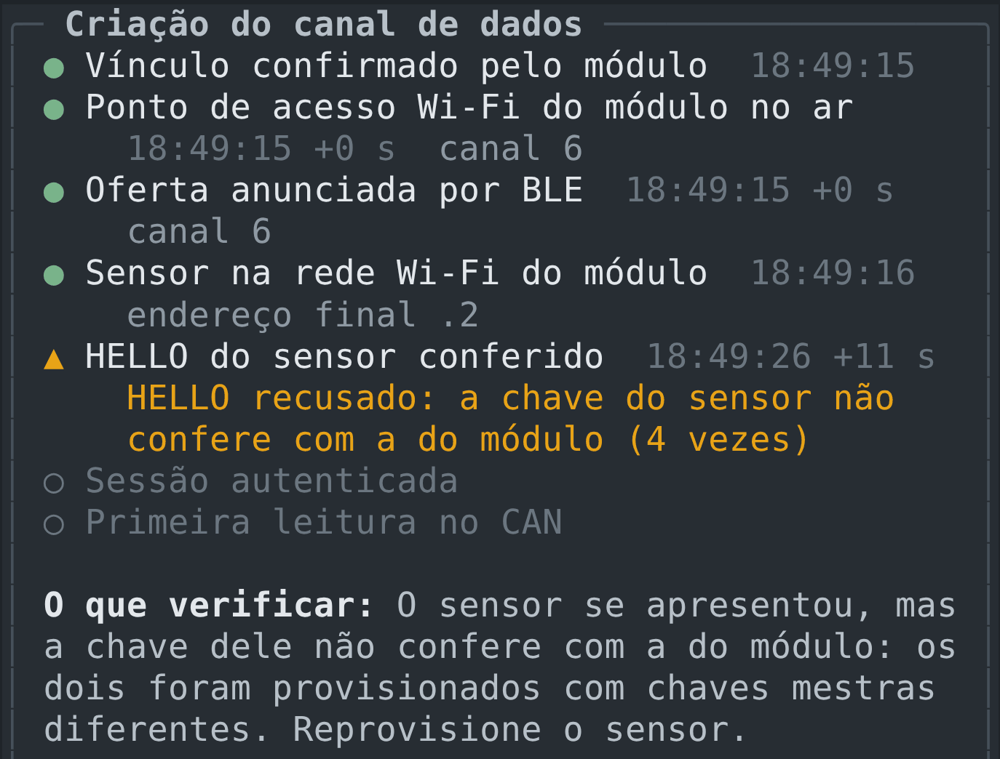

# Guia de uso

Este guia leva da caixa de peças à rede funcionando: o que comprar, como ligar, como gravar cada placa, como colocar a rede no ar e como operá-la no dia a dia. Os comandos são executados na raiz do repositório, num terminal Linux ou macOS.

## 1. O que você precisa

### Equipamentos

| Item | Quantidade | Observação |
|---|---|---|
| ESP32 DevKit com módulo MCP2515 (cristal de 8 MHz, transceptor TJA1050) | 1 para a Probe 00 e 1 por módulo CAN | até 31 módulos; a bancada de referência usa 3 |
| Cabo para o barramento CAN (par trançado) e 2 resistores de 120 Ω | 1 conjunto | um resistor em cada ponta do barramento |
| Raspberry Pi Pico W + acelerômetro MPU6050 | 1 por sensor de vibração | |
| Raspberry Pi Pico W ou Pico 2 W + microfone INMP441 | 1 por sensor acústico | |
| ESP32-2432S028 ("Cheap Yellow Display") | opcional, 1 por painel | a versão com USB-C e micro-USB |
| M5Stack PaperColor | opcional | leitor desta documentação; não faz parte da rede ([seção 9](#9-leitor-da-documentação)) |
| Hub USB com fonte própria | 1 | alimenta os módulos; ver [Alimentação](#alimentação) |
| Computador com USB | 1 | roda a estação de operação (TUI) e grava as placas |

### Programas

| Para | Programa |
|---|---|
| Estação de operação (TUI) | Python 3.11 ou mais novo |
| Gravar a Probe 00, os módulos, o painel e o leitor | PlatformIO Core: `python3 -m pip install platformio` |
| Gravar os sensores (Pico W e Pico 2 W) | Pico SDK 2.3.1 com submódulos, a variável `PICO_SDK_PATH` apontando para ele, CMake 3.13 ou mais novo e o compilador `arm-none-eabi-gcc` |

## 2. Ligações

### Módulo CAN e Probe 00

A Probe 00 e os módulos usam a mesma placa e as mesmas ligações; o que muda é o número gravado.

| MCP2515 | ESP32 |
|---|---|
| SCK | GPIO 13 |
| SO (MISO) | GPIO 19 |
| SI (MOSI) | GPIO 23 |
| CS | GPIO 5 |
| INT | GPIO 4 |

Três LEDs opcionais mostram o estado do módulo, acesos com o pino em nível baixo: líder no GPIO 25, falha no GPIO 26 e estado no GPIO 27.

Ligue CAN_H com CAN_H e CAN_L com CAN_L em todas as placas, num cabo único, e coloque um resistor de 120 Ω entre CAN_H e CAN_L em cada uma das duas pontas. Sem as duas terminações o barramento acumula erros. A taxa é fixa em 500 kbit/s.

### Sensor de vibração

| MPU6050 | Pico W |
|---|---|
| SDA | GP0 |
| SCL | GP1 |
| VCC | 3V3(OUT) |
| GND | GND |

### Sensor acústico

| INMP441 | Pico W ou Pico 2 W | Pino físico |
|---|---|---|
| SCK | GP18 | 24 |
| WS | GP19 | 25 |
| SD | GP20 | 26 |
| L/R | GND | 23 |
| VDD | 3V3(OUT) | 36 |
| GND | GND | 23 ou 28 |

Detalhes, e como trocar os pinos, em [Sensor acústico](sensor-acustico.md#2-hardware-e-ligação).

### Painel

O painel não precisa de ligações além da alimentação. A porta USB-C dessa placa não liga com cabo USB-C dos dois lados: use um cabo USB-A para USB-C ou a porta micro-USB. Para ouvir os avisos sonoros, ligue um alto-falante pequeno no conector `SPEAK`.

### Alimentação

Cada módulo consome de 100 a 200 mA em média, com picos de 300 a 500 mA quando o rádio transmite ou calibra. Três módulos ligados juntos passam de 1 A nos picos. Um power bank comum não sustenta isso: a tensão cai e as placas reiniciam juntas, repetindo o pico.

Na bancada, alimente os módulos por um hub USB com fonte própria (o projeto usa um hub Acasis) ou por uma fonte de 5 V com 3 A ou mais, com cabos curtos. Se as placas dividirem a mesma alimentação, um capacitor eletrolítico de 470 a 1000 µF entre 5 V e GND perto de cada uma ajuda. Para confirmar um problema de alimentação, veja a [solução de problemas](#11-solução-de-problemas).

## 3. Preparar o computador

```bash
git clone https://github.com/marcelo-carvalhop/iot-over-can.git
cd iot-over-can
./Codigo/scripts/setup_tui.sh          # cria Front/.venv e instala a estação
```

`setup_tui.sh` pode ser executado de novo a qualquer momento para atualizar a instalação.

## 4. Credenciais

O canal de dados entre sensores e módulos usa chaves secretas. Elas são geradas uma vez, no computador que grava as placas:

```bash
./Codigo/scripts/provision_sensor_security.sh            # gera as credenciais, se ainda não existirem
./Codigo/scripts/provision_sensor_security.sh --check    # confere sem mostrar os segredos
```

| Arquivo | Conteúdo | Quem usa |
|---|---|---|
| `.env.local` (raiz do repositório) | token de manutenção e chave mestra do canal de dados | gravação dos módulos e dos sensores |
| `.env.sensor-<UUID>.local` | chaves derivadas para um único sensor | gravação daquele sensor |
| `~/.config/iot-over-can/security.json` | token de manutenção | estação de operação |

Esses arquivos ficam fora do Git (o `.gitignore` cobre `*.local`) e com permissão de leitura só para o dono. Nenhum outro script gera chaves: os de gravação só leem `.env.local`. Para gravar placas em outro computador, copie os arquivos por um meio seguro; chaves geradas separadamente não conversam entre si. A explicação completa está em [Segurança](seguranca.md).

## 5. Gravar as placas

### Probe 00 e módulos CAN

Cada placa recebe um número: 0 é a Probe 00, de 1 a 31 são os módulos. Conecte uma placa por vez:

```bash
pio device list                                            # descobre a porta
./Codigo/scripts/upload_esp32_can_node.sh 0 /dev/ttyUSB0   # Probe 00
./Codigo/scripts/upload_esp32_can_node.sh 1 /dev/ttyUSB0   # módulo 1
./Codigo/scripts/upload_esp32_can_node.sh 2 /dev/ttyUSB0   # módulo 2
```

Use sempre o script: ele fornece o número e a chave. O botão de gravar do editor não fornece nenhum dos dois, e a compilação sem número para com erro de propósito. Para só compilar, use `build_esp32_can_node.sh <número>`.

Confira no monitor serial (`pio device monitor -b 115200`), logo depois de ligar:

- na Probe 00: `[PROBE 00] FIRMWARE=...`;
- nos módulos: `[WLINK] LINK_KEY=PROVISIONED`. `MISSING` significa que a placa foi gravada sem chave.

Opções de compilação dos módulos, passadas por `PLATFORMIO_BUILD_FLAGS`:

| Opção | Efeito |
|---|---|
| `-D IOT_FAULT_INJECTION=0` | remove os ensaios de falha; use fora da bancada |
| `-D IOT_FOLLOWER_LEADER_WATCHDOG=0` | desativa a vigilância do líder pelos outros módulos |

```bash
PLATFORMIO_BUILD_FLAGS="-D IOT_FAULT_INJECTION=0" ./Codigo/scripts/upload_esp32_can_node.sh 1 /dev/ttyUSB0
```

### Sensor de vibração

Na bancada, a forma mais simples grava a chave mestra no sensor:

```bash
./Codigo/scripts/build_pico.sh
```

O script deve informar `Enlace: chave mestra (bancada)`. Para gravar, segure o botão BOOTSEL do Pico W, conecte o USB e copie `Codigo/node-wifi/build/edge_node_firmware.uf2` para a unidade `RPI-RP2` que aparece.

Um sensor de uso permanente não deve guardar a chave mestra. Gere as chaves só dele, a partir do número de identificação (UUID), que aparece no console serial do sensor com o comando `VERSION` (`NODE_UUID=0x...`) ou na tela Sensores sem fio:

```bash
./Codigo/scripts/provision_sensor_security.sh --sensor E6616408432B6F39
./Codigo/scripts/build_pico.sh --sensor E6616408432B6F39
```

### Sensor acústico

O mesmo procedimento, com `--audio`:

```bash
./Codigo/scripts/build_pico.sh pico_w --audio                      # Pico W, chave mestra
./Codigo/scripts/build_pico.sh pico2_w --audio --sensor <UUID>     # Pico 2 W, chaves só dele
```

O arquivo gerado é `Codigo/node-audio/build/edge_audio_firmware.uf2`; no Pico 2 W a unidade que aparece com BOOTSEL se chama `RP2350`. Depois de gravar, no console USB (115200), `STATUS` deve mostrar `MIC=OK` e `COVERAGE_PCT=100`. Sem sinal do microfone, o console escreve uma linha `[MIC]` com os pinos a conferir.

### Painel

```bash
./Codigo/scripts/build_paper.sh --upload /dev/ttyUSB0
```

Na primeira partida:

1. A tela mostra barras vermelha, verde, azul e branca. Se as cores saírem trocadas, ajuste `CYD_INVERT` ou `CYD_RGB_ORDER` em `build_flags` do ambiente `cyd`, em `Codigo/node-paper/platformio.ini`. Se a imagem sair de lado ou espelhada, ajuste `CYD_ROTATION` (0 a 7). A versão só com micro-USB usa outro controlador de tela: acrescente `-D CYD_PANEL_ILI9341=1`.
2. Em seguida vem a calibração do toque: toque nos marcadores que aparecem nos quatro cantos. A calibração fica gravada; para refazê-la, ligue a placa segurando o botão BOOT.

### Quando gravar de novo

| O que mudou | O que gravar |
|---|---|
| código dos módulos | todos os módulos e a Probe 00, na mesma versão |
| credenciais renovadas (`--renew`) | todos os módulos e todos os sensores |
| código dos sensores | os sensores |
| código do painel | os painéis |
| a documentação | o leitor, se quiser o texto novo nele ([seção 9](#9-leitor-da-documentação)) |
| só a estação de operação | nada; basta reabri-la |

## 6. Colocar a rede no ar

1. **Ligue o barramento e os módulos.** Os LEDs acendem durante a partida.
2. **Abra a estação** com a porta da Probe 00:

   ```bash
   ./Codigo/scripts/run_tui.sh /dev/ttyUSB0
   ```

   No modo padrão, comandos que alteram a rede (associação, eleição, ensaios) pedem a chave física do operador (YubiKey). Na bancada, sem ela: `SECURITY_MODE=off ./Codigo/scripts/run_tui.sh /dev/ttyUSB0`.
3. **Confira a rede** na tela Início: todos os módulos e um líder. Sem líder, peça a eleição em Comandos (`F4` ou `c`). A estação acerta o relógio da rede sozinha ao conectar.
4. **Ligue um sensor** e abra Sensores sem fio (`F7` ou `w`). O sensor aparece em Disponíveis, com o módulo que o ouve melhor. Pressione `Enter`, escolha o módulo responsável e a política de reassociação.
5. **Acompanhe o canal de dados** na tela do sensor. A seção Criação do canal de dados mostra cada etapa, do vínculo à primeira leitura; quando a sessão abre, chegam as leituras.

   

6. **Ligue o painel**, se houver. Ele aparece em Sensores sem fio como os sensores e é associado do mesmo jeito.

## 7. Operação do dia a dia

| Tarefa | Onde | Tecla |
|---|---|---|
| Ver a situação geral | Início | `F2` ou `i` |
| Associar ou desassociar um sensor | Sensores sem fio | `F7` ou `w`, depois `Enter` ou `d` |
| Mudar a política de reassociação | Sensores sem fio, lista Associados | `f` |
| Pedir um espectro | tela do sensor | `f` |
| Mudar a configuração de um sensor | tela do sensor | `c` |
| Definir limites de alarme | tela do sensor | `l` |
| Pedir eleição, consultar ou limpar a falha de um módulo | Comandos | `F4` ou `c` |
| Ver ocupação do barramento e tempos de resposta | Métricas da rede | `F8` ou `b`; `x` exporta |
| Provocar uma falha controlada | Ensaios | `F9` ou `e` |
| Rever o que aconteceu em sessões anteriores | Histórico | `F11` ou `h` |
| Acompanhar vários sensores numa tela | Supervisório | `F12` ou `v` |
| Digitar um comando qualquer | lançador de comandos | `k` |

Todas as telas estão descritas em [TUI](tui.md).

## 8. Painel de operação

O painel mostra a situação da rede no local, sem computador. Ele recebe do módulo a que está associado tudo o que passa no barramento e compõe a página sozinho.

- **Cabeçalho:** o nível da situação, com a cor de fundo correspondente (Rede normal, A rede está tratando, Atenção, Requer você), o módulo a que o painel está ligado e a hora.
- **Páginas:** Situação (o que requer atenção, ou o resumo da rede) e Rede (líder, módulos, ocupação do barramento e cada sensor com a última leitura).
- **Botões na parte de baixo da tela:** Situação e Rede trocam a página; Marcar registra o instante na linha do tempo da estação (por exemplo, "mexi no cabo agora") e, com um alerta pendente, vale como Ciente; Ciente confirma que o operador viu o alerta.
- **LED e avisos sonoros:** verde com a rede normal; azul pulsando quando a rede está tratando um problema sozinha (1 bipe); amarelo piscando em atenção (2 bipes, repetidos a cada 5 min); vermelho em "requer você" (3 bipes, repetidos a cada minuto). Ciente para os bipes e registra o tempo de reação na estação ("Ciente em 80 s: Node 1 sem sinal").
- **Hora:** o painel não tem relógio próprio. Ele pede a hora à rede ao conectar; sem estação conectada à rede, mostra tempos relativos ("há 3 min").

## 9. Leitor da documentação

O M5Stack PaperColor não faz parte da rede: é um leitor de bolso desta documentação. O README e todos os documentos de `Documentacao/` vão gravados no firmware, convertidos dos arquivos `.md` a cada compilação. A tela de papel eletrônico colorido guarda a imagem sem energia, então a página aberta continua à vista com o leitor desligado.

```bash
./Codigo/scripts/build_leitor.sh --upload /dev/ttyACM0
```

Quando a documentação mudar, grave de novo. O leitor guarda a página em que parou em cada documento; se o texto mudou, ele recomeça pela biblioteca.

| Botão | Biblioteca | Seções de um documento | Leitura |
|---|---|---|---|
| A | sobe | sobe | página anterior |
| B | abre o documento | abre a seção | mostra as seções |
| C | desce | desce | próxima página |
| segurar A ou C | sobe ou desce | dez de cada vez | seção anterior ou seguinte |
| segurar B | nada | volta ao texto | volta à biblioteca |

- **Tempo de desenho:** a tela colorida leva de 15 a 30 s para desenhar. Toques seguidos se somam: três toques em C avançam três páginas com um desenho só. Enquanto a tela desenha, o LED fica azul.
- **Energia:** na bateria, depois de 20 s sem uso o leitor dorme com a página na tela, e qualquer botão o acorda. Depois de 30 min dormindo, ele se desliga. O botão de energia segue o padrão de fábrica: um toque liga, dois toques desligam. Ao ligar, o leitor volta à página em que estava, sem redesenhar a tela.
- **Teclado (opcional):** um M5Stack CardKB na Port A. As setas para os lados viram a página e as setas para cima e para baixo pulam de seção; Enter abre, Esc volta e, na biblioteca, as teclas 1 a 0 abrem os documentos direto.
- **Pela USB:** no monitor serial (115200), `a`, `b` e `c` tocam os botões, `A`, `B` e `C` os seguram e `s` mostra onde o leitor está.

## 10. Sem hardware

### Demonstração

```bash
Front/.venv/bin/iot-over-can-tui --demo
```

Uma rede inventada, com módulos, sensores de vibração e um sensor acústico, que reage a comandos e configurações. Os ensaios de falha não têm efeito nela.

### Reproduzir uma sessão gravada

```bash
cd Front
.venv/bin/python -m pico_tui --replay replays/owner_failover.log --replay-speed 4
```

`Front/replays/` tem uma gravação de cada cenário da bancada virtual, que roda o firmware real dos módulos. Métricas e ensaios funcionam sobre a gravação. As sessões reais também ficam gravadas em `Front/logs/` e podem ser reproduzidas do mesmo jeito.

### Laboratório virtual

O laboratório roda a Probe 00 e vários módulos simulados, com o firmware real, e liga a estação a eles como se fosse a bancada:

```bash
./Codigo/scripts/build_network_sim.sh /tmp/ioc_sim_network
cd Front && .venv/bin/python -m pico_tui --sim --sim-binary /tmp/ioc_sim_network
```

Com o laboratório aberto, `python3 Simulacao/sim_ctl.py` muda a topologia em funcionamento (`NODE 4 ADD`, `PAUSE`, `RESUME`, `STATUS`). O Simulation Studio mostra o mesmo laboratório no navegador, com a topologia, os instrumentos e experimentos prontos:

```bash
python3 Simulacao/studio/server.py --binary /tmp/ioc_sim_network --browser    # http://127.0.0.1:8765
```

Um sensor real pode participar do laboratório pela USB, no lugar do rádio: `Front/.venv/bin/python Simulacao/usb_sensor_bridge.py --port /dev/ttyACM0 --node 1 --rssi -55`. `./Simulacao/iniciar_laboratorio.py` abre Studio, estação e ponte em três terminais de uma vez. Detalhes em [Validação](validacao.md#4-laboratório-virtual).

## 11. Solução de problemas

| Sintoma | Causa provável | O que fazer |
|---|---|---|
| Módulos reiniciam sozinhos, vários ao mesmo tempo | alimentação insuficiente | no monitor serial, `rst:0xf (BROWNOUT_RST)` confirma; use o hub com fonte ou uma fonte de 3 A |
| Módulo mostra `[WLINK] LINK_KEY=MISSING` | gravado sem chave (`.env.local` antigo ou ausente) | `provision_sensor_security.sh --check`; se faltar a chave, `--add-link-key` e grave de novo |
| Canal de dados parado em "HELLO recusado: a chave não confere" | sensor e módulo gravados com chaves diferentes | grave os dois com as mesmas credenciais |
| Canal de dados parado antes de "Sensor na rede Wi-Fi do módulo" | sensor sem sinal do módulo, ou com firmware antigo | aproxime o sensor; confira no console dele as linhas `[NET]` |
| Sensor não aparece em Disponíveis | sensor desligado, longe ou com firmware de outra versão | confira o console do sensor (`VERSION`) e se algum módulo o observa |
| Nenhum líder na tela Início | a rede ainda não fez a eleição | Comandos, Iniciar eleição |
| A estação não encontra a porta | porta ocupada por outro programa ou sem permissão | feche monitores seriais; no Linux, inclua o usuário no grupo `dialout` |
| Cores trocadas ou imagem girada no painel | outra variante da placa | ajuste `CYD_INVERT`, `CYD_RGB_ORDER` ou `CYD_ROTATION` (seção 5) |
| Toque do painel fora do lugar | calibração antiga | ligue o painel segurando BOOT para recalibrar |
| Painel sem hora no cabeçalho | nenhuma estação conectada à rede desde que ele ligou | conecte a estação à Probe 00; a hora chega em segundos |
