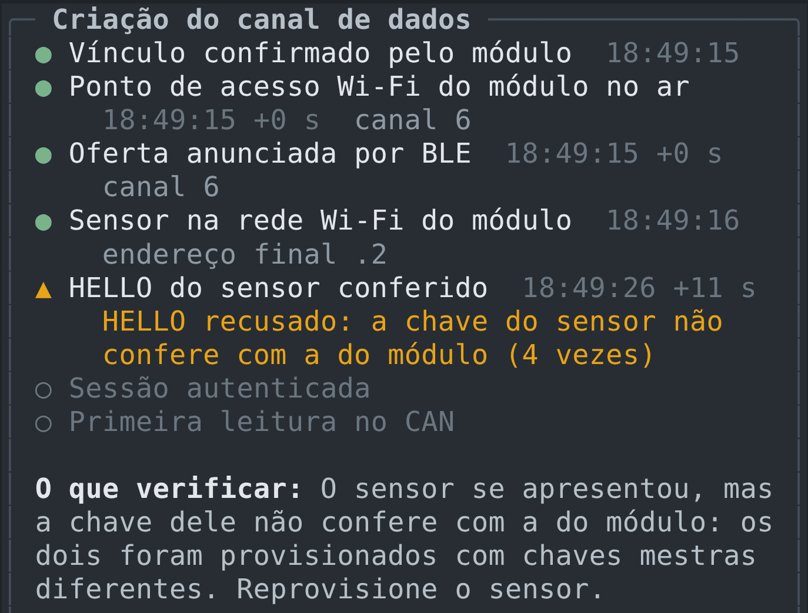

# Guia de uso

Este guia leva da caixa de peças à rede funcionando: o que comprar, como ligar, como gravar cada placa, como colocar a rede no ar e como operá-la no dia a dia. Os comandos são executados na raiz do repositório, num terminal Linux ou macOS.

## 1. O que você precisa

### Equipamentos

| Item | Quantidade | Observação |
|---|---|---|
| ESP32 DevKit com módulo MCP2515 (cristal de 8 MHz, transceptor TJA1050) | 1 para a Probe 00 e 1 por módulo CAN | até 31 módulos; a bancada de referência usa 3 |
| Cabo para o barramento CAN (par trançado) e 2 resistores de 120 Ω | 1 conjunto | um resistor em cada ponta do barramento |
| Raspberry Pi Pico W + acelerômetro MPU6050 | 1 por sensor de vibração | |
| Raspberry Pi Pico W ou Pico 2 W + microfone INMP441 | 1 por sensor acústico | |
| ESP32-2432S028 ("Cheap Yellow Display") | opcional, 1 por painel | a versão com USB-C e micro-USB |
| M5Stack PaperColor | opcional | leitor desta documentação; não faz parte da rede ([seção 9](#9-leitor-da-documentação)) |
| Hub USB com fonte própria | 1 | alimenta os módulos; ver [Alimentação](#alimentação) |
| Computador com USB | 1 | roda a estação de operação (TUI) e grava as placas |

### Programas

| Para | Programa |
|---|---|
| Estação de operação (TUI) | Python 3.11 ou mais novo |
| Gravar a Probe 00, os módulos, o painel e o leitor | PlatformIO Core: `python3 -m pip install platformio` |
| Gravar os sensores (Pico W e Pico 2 W) | Pico SDK 2.3.1 com submódulos, a variável `PICO_SDK_PATH` apontando para ele, CMake 3.13 ou mais novo e o compilador `arm-none-eabi-gcc` |

## 2. Ligações

### Módulo CAN e Probe 00

A Probe 00 e os módulos usam a mesma placa e as mesmas ligações; o que muda é o número gravado.

| MCP2515 | ESP32 |
|---|---|
| SCK | GPIO 13 |
| SO (MISO) | GPIO 19 |
| SI (MOSI) | GPIO 23 |
| CS | GPIO 5 |
| INT | GPIO 4 |

Três LEDs opcionais mostram o estado do módulo, acesos com o pino em nível baixo: líder no GPIO 25, falha no GPIO 26 e estado no GPIO 27.

Ligue CAN_H com CAN_H e CAN_L com CAN_L em todas as placas, num cabo único, e coloque um resistor de 120 Ω entre CAN_H e CAN_L em cada uma das duas pontas. Sem as duas terminações o barramento acumula erros. A taxa é fixa em 500 kbit/s.

### Sensor de vibração

| MPU6050 | Pico W |
|---|---|
| SDA | GP0 |
| SCL | GP1 |
| VCC | 3V3(OUT) |
| GND | GND |

### Sensor acústico

| INMP441 | Pico W ou Pico 2 W | Pino físico |
|---|---|---|
| SCK | GP18 | 24 |
| WS | GP19 | 25 |
| SD | GP20 | 26 |
| L/R | GND | 23 |
| VDD | 3V3(OUT) | 36 |
| GND | GND | 23 ou 28 |

Detalhes, e como trocar os pinos, em [Sensor acústico](sensor-acustico.md#2-hardware-e-ligação).

### Painel

O painel não precisa de ligações além da alimentação. A porta USB-C dessa placa não liga com cabo USB-C dos dois lados: use um cabo USB-A para USB-C ou a porta micro-USB. Para ouvir os avisos sonoros, ligue um alto-falante pequeno no conector `SPEAK`.

### Alimentação

Cada módulo consome de 100 a 200 mA em média, com picos de 300 a 500 mA quando o rádio transmite ou calibra. Três módulos ligados juntos passam de 1 A nos picos. Um power bank comum não sustenta isso: a tensão cai e as placas reiniciam juntas, repetindo o pico.

Na bancada, alimente os módulos por um hub USB com fonte própria (o projeto usa um hub Acasis) ou por uma fonte de 5 V com 3 A ou mais, com cabos curtos. Se as placas dividirem a mesma alimentação, um capacitor eletrolítico de 470 a 1000 µF entre 5 V e GND perto de cada uma ajuda. Para confirmar um problema de alimentação, veja a [solução de problemas](#11-solução-de-problemas).

### LEDs piscando e pulsos no GND

**O que é normal.** O LED de estado (GPIO 27) acende por 80 ms a cada heartbeat da rede, 1 s por padrão. O de líder (GPIO 25) fica aceso no líder e o de falha (GPIO 26), numa falha ou com o sensor local desligado. Os três acesos ao mesmo tempo são o estado de espera, da partida até a eleição; por isso uma placa que reinicia em ciclo parece piscar, já que a cada partida os três acendem juntos. O programa só muda esses pinos quando a rede muda de estado ou a cada heartbeat, e eles não são pinos de boot nem do rádio: nenhum outro trecho do código os faz pulsar.

**O que é esperado numa protoboard.** O rádio puxa corrente em ritmo próprio: a varredura BLE ocupa 50 ms a cada 100 ms e o ponto de acesso, no ar enquanto o módulo tem sensor associado, emite um beacon a cada 102 ms. Pelo datasheet do ESP32, uma transmissão chega a 240 mA e a recepção consome de 95 a 100 mA. Essa corrente passa pela resistência e pela indutância dos fios da protoboard, do cabo USB e da fonte, e aparece na alimentação e no GND da placa como pulsos, que o osciloscópio mostra mesmo com tudo funcionando. Pulsos assim, sozinhos, raramente mudam o brilho de um LED. O LED pisca de verdade quando a tensão cai a ponto de reiniciar a placa ou quando o LED está ligado de um jeito que o torna sensível ao ruído (ver abaixo).

**Como saber em que caso você está.**

1. No monitor serial do módulo, digite `ENERGIA`:

   ```text
   [NODE 2] [ENERGIA] reinicio=ENERGIA_LIGADA quedas_de_tensao=0 watchdog=0 panico=0 wifi_tx_max_dbm=11.00
   ```

   A resposta traz o motivo da última partida e a contagem, desde a última limpeza (`ENERGIA LIMPAR`), de reinícios por queda de tensão, watchdog e falha do programa. Contagem de quedas de tensão acima de zero é problema de alimentação: a placa reiniciou porque a tensão caiu. Só os reinícios anormais são contados e gravados; ligar a placa, apertar EN e abrir a porta serial não contam. Uma partida anormal escreve também `[ENERGIA] ATENCAO: ...` ao ligar.
2. Com a contagem parada e só o LED de estado pulsando (80 ms por segundo), a placa está normal. Os pulsos vistos no osciloscópio são elétricos e valem as medidas abaixo.

**Medir sem se enganar.**

1. Use a mola de aterramento da ponta ou um fio de terra de até 3 cm. O fio de terra longo, com jacaré, forma uma espira que capta ruído e desenha pulsos que não existem na placa.
2. Meça entre os pinos 3V3 e GND da própria placa, com acoplamento CC e banda limitada a 20 MHz. Medir o GND contra o terra do osciloscópio mostra o que há entre a placa e a tomada, não o que a placa vê: esse terra costuma ir ao fio terra da tomada, e o caminho até a placa passa pelo computador e pelos cabos.
3. Dispare no pulso e leia o período: 102 ms são os beacons do ponto de acesso, 100 ms a varredura BLE e 1 s o heartbeat. Um pulso isolado e irregular, seguido de nova partida da placa, é queda de tensão.
4. Repita com três montagens na mesma protoboard e na mesma fonte: a placa gravada como Probe 00 (sem BLE e sem ponto de acesso), um módulo sem sensor associado (só a varredura BLE) e um módulo com sensor associado (BLE e beacons). Se os pulsos acompanham o rádio, a origem é a corrente do rádio na alimentação; se aparecem também na Probe 00, procure no cabo, na fonte e nas ligações do MCP2515.
5. A faixa de operação do ESP32 é de 3,0 a 3,6 V. Se o 3V3 sai dela durante os pulsos, a alimentação é o problema, mesmo que a placa não reinicie.

**O que melhorar na montagem.**

- Alimente cada placa direto do hub USB com fonte própria, com cabos curtos e grossos, em vez de encadeá-las pelos trilhos da protoboard. Em muitas protoboards os trilhos de alimentação são interrompidos no meio: confira com um multímetro.
- Ponha, perto de cada placa, o eletrolítico de 470 a 1000 µF entre 5 V e GND (já recomendado acima) e um cerâmico de 100 nF em paralelo, com fios de até 3 cm.
- Com o ânodo do LED em 5 V, um pino a 3,3 V não o apaga de vez: sobram cerca de 1,7 V sobre o LED e o resistor, e o LED fica fraco e sensível a qualquer ruído. Ligue o ânodo ao 3V3, com resistor de 330 Ω a 1 kΩ.
- Confira a tensão que o MCP2515 entrega ao ESP32 em SO (MISO, GPIO 19) e INT (GPIO 4). Os módulos de 5 V com TJA1050 mandam 5 V, acima do que o pino do ESP32 aceita, e a corrente que entra pelo pino pode subir para o 3V3. Um conversor de nível de 5 V para 3,3 V nesses dois sinais resolve. Isso não explica os pulsos por si, mas é o ponto fraco da ligação.

**O que o firmware faz.** Limita a potência do ponto de acesso a 11 dBm (o padrão do ESP32 é 19,5 dBm), o que reduz o pico de cada beacon e de cada datagrama enviado ao sensor; registra o motivo dos reinícios (`ENERGIA`); e só liga o ponto de acesso quando há sensor associado. Ele não elimina o ruído da alimentação, que é questão de montagem. Se o sensor ficar longe do módulo e o sinal piorar, volte à potência máxima com `-D IOT_WIFI_TX_POWER_QDBM=78` (opções de compilação, seção 5). O efeito do limite sobre os pulsos ainda não foi medido na bancada ([Validação](validacao.md#o-que-ainda-precisa-ser-conferido)).

### Medir a tensão de entrada e a corrente (opcional)

`ENERGIA` diz por que a placa reiniciou, mas não quanto sobrava de tensão antes. Com duas peças baratas o módulo também mede, e só mede: nada no firmware age sobre o que lê.

- **Tensão de entrada:** um divisor resistivo, `Vin ─ R1 ─┬─ R2 ─ GND`, com o ponto do meio num pino do ADC1 do ESP32 (GPIO 32 a 39; o ADC2 não serve, o Wi-Fi o usa). Com R1 = R2 = 100 kΩ e 5 V na entrada, o pino recebe 2,5 V, dentro da faixa do conversor (até cerca de 3,1 V). Meça a entrada da placa (o 5 V do USB ou da fonte), não o 3V3.
- **Corrente:** um módulo INA219 com o resistor de derivação em série com a alimentação (as placas comuns trazem 0,1 Ω, o que dá até 3,2 A), no I²C: SDA no GPIO 21 e SCL no GPIO 22, por padrão. O MCP2515 usa os GPIO 4, 5, 13, 19 e 23, e os LEDs os GPIO 25, 26 e 27: não há conflito.

A medição só existe se for pedida na compilação:

| Opção | Efeito |
|---|---|
| `-D IOT_VIN_ADC_PIN=34` | liga a medição da tensão de entrada no pino indicado (GPIO 32 a 39) |
| `-D IOT_VIN_R1_OHM=100000 -D IOT_VIN_R2_OHM=100000` | os resistores do divisor, em ohms (os padrões) |
| `-D IOT_VIN_WARN_MV=4750` | abaixo disto a tensão é `BAIXA` e o módulo avisa, no máximo a cada 10 s (padrão 4750) |
| `-D IOT_VIN_CRIT_MV=4500` | abaixo disto a tensão é `CRITICA` (padrão 4500) |
| `-D IOT_INA219_ADDR=64` | liga a medição da corrente; endereço I²C do INA219, de 64 (`0x40`) a 79 (`0x4F`) |
| `-D IOT_INA219_SHUNT_MOHM=100` | resistor de derivação, em mΩ (padrão 100) |
| `-D IOT_I2C_SDA=21 -D IOT_I2C_SCL=22` | pinos do I²C (os padrões) |

```bash
PLATFORMIO_BUILD_FLAGS="-D IOT_VIN_ADC_PIN=34 -D IOT_INA219_ADDR=64" ./Codigo/scripts/upload_esp32_can_node.sh 1 /dev/ttyUSB0
```

`ENERGIA` passa a trazer os campos a mais:

```text
[NODE 1] [ENERGIA] reinicio=ENERGIA_LIGADA quedas_de_tensao=0 watchdog=0 panico=0 wifi_tx_max_dbm=11.00 vin_mv=4912 vin_min_mv=4880 vin_max_mv=4935 vin=OK corrente_ma=143 corrente_max_ma=312
```

`vin_mv` é a média das últimas 16 amostras (uma a cada 10 ms); `vin_min_mv` e `vin_max_mv` são os extremos dessas médias desde a partida ou desde o último `ENERGIA LIMPAR`; `vin` é `OK`, `BAIXA` ou `CRITICA` (`SEM_LEITURA` nos primeiros 160 ms). `corrente_ma` é a leitura atual e `corrente_max_ma` o maior valor visto; `corrente=SEM_RESPOSTA` diz que o INA219 não respondeu no I²C. Com a tensão abaixo do limite de aviso o módulo escreve também `[ENERGIA] ATENCAO: tensao de entrada BAIXA, ...`.

**Limites.** A medição mostra o patamar: uma média de 16 amostras a cada 10 ms não vê os pulsos de microssegundos dos beacons, que continuam sendo assunto de osciloscópio (roteiro acima). O conversor do ESP32 erra dezenas de milivolts: compare com um multímetro antes de confiar no valor e use os valores medidos de R1 e R2. A tensão de entrada não é a do 3V3: o ESP32 reinicia quando o 3V3 cai abaixo de cerca de 2,5 V, e a entrada mostra quanto sobrava antes. Nada disto foi validado em hardware; o procedimento é o RT 87 do [roteiro](bancada-fisica/roteiro-de-testes.md) ([Validação](validacao.md#6-bancada-física)).

## 3. Preparar o computador

```bash
git clone https://github.com/marcelo-carvalhop/iot-over-can.git
cd iot-over-can
./Codigo/scripts/setup_tui.sh          # cria Front/.venv e instala a estação
```

`setup_tui.sh` pode ser executado de novo a qualquer momento para atualizar a instalação.

## 4. Credenciais

O canal de dados entre sensores e módulos usa chaves secretas. Elas são geradas uma vez, no computador que grava as placas:

```bash
./Codigo/scripts/provision_sensor_security.sh            # gera as credenciais, se ainda não existirem
./Codigo/scripts/provision_sensor_security.sh --check    # confere sem mostrar os segredos
```

| Arquivo | Conteúdo | Quem usa |
|---|---|---|
| `.env.local` (raiz do repositório) | token de manutenção e chave mestra do canal de dados | gravação dos módulos e dos sensores |
| `.env.sensor-<UUID>.local` | chaves derivadas para um único sensor | gravação daquele sensor |
| `~/.config/iot-over-can/security.json` | token de manutenção | estação de operação |

Esses arquivos ficam fora do Git (o `.gitignore` cobre `*.local`) e com permissão de leitura só para o dono. Nenhum outro script gera chaves: os de gravação só leem `.env.local`. Para gravar placas em outro computador, copie os arquivos por um meio seguro; chaves geradas separadamente não conversam entre si. A explicação completa está em [Segurança](seguranca.md).

## 5. Gravar as placas

### Probe 00 e módulos CAN

Cada placa recebe um número: 0 é a Probe 00, de 1 a 31 são os módulos. Conecte uma placa por vez:

```bash
pio device list                                            # descobre a porta
./Codigo/scripts/upload_esp32_can_node.sh 0 /dev/ttyUSB0   # Probe 00
./Codigo/scripts/upload_esp32_can_node.sh 1 /dev/ttyUSB0   # módulo 1
./Codigo/scripts/upload_esp32_can_node.sh 2 /dev/ttyUSB0   # módulo 2
```

Use sempre o script: ele fornece o número e a chave. O botão de gravar do editor não fornece nenhum dos dois, e a compilação sem número para com erro de propósito. Para só compilar, use `build_esp32_can_node.sh <número>`.

Os módulos (1 a 31) só compilam e só gravam com a chave mestra do enlace em `.env.local`. Sem ela o módulo associaria sensores, mas responderia `NO_KEY` e nunca abriria o ponto de acesso, e um aviso no meio da saída do PlatformIO já passou despercebido (CH-056). Por isso o script para com erro; para compilar assim de propósito (por exemplo, só para testar a compilação), acrescente `--sem-chave`. A Probe 00 não usa a chave.

Confira no monitor serial (`pio device monitor -b 115200`), logo depois de ligar:

- em todas as placas: `[NODE <n>] [BOOT] FIRMWARE=<versão> COMMIT=<commit> PROTOCOL=CAN_CLASSIC_V1 ROLE=PROBE` (ou `ROLE=NODE`). É a versão (a do arquivo `VERSION`) e o commit que a placa tem gravado. `COMMIT=...-dirty` diz que ela foi gravada com alterações locais, e `unknown`, que a compilação não estava num repositório git. Placas com versão ou commit diferentes na mesma bancada explicam muito comportamento estranho: confira que todas dizem o mesmo (nos módulos, o comando `VERSION` repete a informação);
- na Probe 00: `[PROBE 00] FIRMWARE=... COMMIT=... FEATURES=...`;
- nos módulos: `[WLINK] LINK_KEY=PROVISIONED`. `MISSING` significa que a placa foi gravada sem chave.

O script de fumaça confere tudo isso, e mais, de uma vez (ver [Verificar depois de gravar](#verificar-depois-de-gravar)).

**Autoteste do módulo.** Com a placa ainda fora da rede (sem outra placa transmitindo no barramento), o comando `SELFTEST` no monitor serial confere o controlador CAN sozinho: lê os contadores de erro, manda quatro quadros pelo laço interno do MCP2515 e confere que voltam iguais, e acende os três LEDs um por vez e depois juntos (`SELFTEST CAN` e `SELFTEST LEDS` rodam só uma das partes).

```text
[NODE 2] [SELFTEST] INICIO PARTES=CAN,LEDS ESTADO=IDLE
[NODE 2] [SELFTEST] CHECK=CAN_ERRORS RESULT=PASS REASON=OK REC=0 TEC=0 EFLG=0x00
[NODE 2] [SELFTEST] CHECK=CAN_LOOPBACK RESULT=PASS REASON=OK FRAMES=4/4
[NODE 2] [SELFTEST] CHECK=LEDS RESULT=VISUAL SEQUENCE=LEADER,STATUS,FAULT,ALL
[NODE 2] [SELFTEST] RESULT=PASS CHECKS=2 WARN=0 FAIL=0 DURATION_MS=...
```

Cada defeito vem com uma linha `DICA:` dizendo o que conferir (por exemplo, fio INT ou SCK, MOSI e MISO, ou a alimentação e o cristal do módulo MCP2515). O que reprova aqui é defeito da placa ou da ligação ao controlador, não do barramento. Depois que a placa entra na rede o comando é recusado de propósito (`RECUSADO ESTADO=...`): o teste tira o controlador do barramento por instantes. Reinicie a placa com o cabo solto e repita. O LED não entra no veredito, porque só o olho o confirma.

Opções de compilação dos módulos, passadas por `PLATFORMIO_BUILD_FLAGS`:

| Opção | Efeito |
|---|---|
| `-D IOT_FAULT_INJECTION=0` | remove os ensaios de falha; use fora da bancada |
| `-D IOT_FOLLOWER_LEADER_WATCHDOG=0` | desativa a vigilância do líder pelos outros módulos |
| `-D IOT_WIFI_TX_POWER_QDBM=78` | potência máxima do ponto de acesso, em quartos de dBm (8 a 84). O padrão é 44 (11 dBm); 78 devolve os 19,5 dBm do ESP32, para sensores longe do módulo |
| `-D IOT_ISOLATION_MS=6000`, `-D IOT_ISOLATION_RECOVER_MS=3000` | tempo sem nenhum quadro (e com transmissões sem confirmação) até o módulo se declarar isolado do barramento, e de quadros contínuos até voltar; `IOT_ISOLATION_MS=0` desliga a detecção (ver [Módulo isolado do barramento](#módulo-isolado-do-barramento)) |
| `-D IOT_VIN_ADC_PIN`, `-D IOT_INA219_ADDR` e demais | medição da tensão de entrada e da corrente (ver [Medir a tensão de entrada e a corrente](#medir-a-tensão-de-entrada-e-a-corrente-opcional)) |
| `--auth-can` (opção dos scripts `build_esp32_can_node.sh` e `upload_esp32_can_node.sh`, que define `IOT_CAN_AUTH=1`) | autentica os comandos `0x304` e `0x305` da Probe. Grave **todos** os módulos e a Probe 00 com ela; a Probe também precisa da chave de enlace. Estado e acerto do contador: comando serial `CANAUTH` e `CANAUTH SYNC <n>` ([Segurança](seguranca.md#autenticação-de-origem-dos-comandos-opcional)) |

```bash
PLATFORMIO_BUILD_FLAGS="-D IOT_FAULT_INJECTION=0" ./Codigo/scripts/upload_esp32_can_node.sh 1 /dev/ttyUSB0
```

### Sensor de vibração

Na bancada, a forma mais simples grava a chave mestra no sensor:

```bash
./Codigo/scripts/build_pico.sh
```

O script deve informar `Enlace: chave mestra (bancada)`. Sem chave nenhuma ele para com erro, a menos que se acrescente `--sem-chave` (o sensor então anuncia por BLE, mas nunca abre sessão). Para gravar, segure o botão BOOTSEL do Pico W, conecte o USB e copie `Codigo/node-wifi/build/pico_w/edge_node_firmware.uf2` para a unidade `RPI-RP2` que aparece.

Cada placa e cada sensor tem a sua pasta de saída: `build/pico_w/`, `build/pico2_w/`, `build/pico_w-<UUID>/`. Compilar para outra placa ou para outro sensor não apaga o arquivo anterior, então vários sensores podem ficar prontos para gravar de uma vez.

Um sensor de uso permanente não deve guardar a chave mestra. Gere as chaves só dele, a partir do número de identificação (UUID), que aparece no console serial do sensor com o comando `VERSION` (`NODE_UUID=0x...`) ou na tela Sensores sem fio:

```bash
./Codigo/scripts/provision_sensor_security.sh --sensor E6616408432B6F39
./Codigo/scripts/build_pico.sh --sensor E6616408432B6F39
```

Depois de gravar, no console USB (115200, prompt `EDGE>`), `VERSION` mostra a versão e o commit gravados: `VERSION FIRMWARE=<versão> COMMIT=<commit> PROTOCOL=6 NODE_UUID=0x...`. Se a porta estava aberta na partida, o console escreveu também `BOOT FIRMWARE=... COMMIT=... PROTOCOL=6 PROFILE=VIBRATION`.

**Esperas do sensor.** Dois tempos do sensor pesam na reassociação para outro módulo: 10 s sem `CMD_PING` até largar a sessão e 15 s, depois de entrar no ponto de acesso de um módulo, até seguir a oferta de outro. São parâmetros de compilação, `--espera-sessao <ms>` (de 7000 a 60000) e `--espera-oferta <ms>` (de 1000 a 120000), e os padrões são os de sempre. Só mude com medição na bancada física: o procedimento e a projeção da bancada virtual estão em [Validação](validacao.md#esperas-do-sensor). Cada combinação tem a sua pasta de saída (`build/pico_w-sess7000-oferta5000/`), sem apagar o `.uf2` padrão. Valem também para o sensor acústico.

### Sensor acústico

O mesmo procedimento, com `--audio`:

```bash
./Codigo/scripts/build_pico.sh pico_w --audio                      # Pico W, chave mestra
./Codigo/scripts/build_pico.sh pico2_w --audio --sensor <UUID>     # Pico 2 W, chaves só dele
./Codigo/scripts/build_pico.sh pico_w --audio --mic-pins 10,12     # microfone em outros pinos
```

O arquivo gerado é `Codigo/node-audio/build/<placa>[-<UUID>][-mic<SCK>-<SD>]/edge_audio_firmware.uf2`, por exemplo `build/pico_w/` ou `build/pico2_w-mic10-12/`; no Pico 2 W a unidade que aparece com BOOTSEL se chama `RP2350`. `--mic-pins SCK,SD` troca os pinos do INMP441 (o WS é sempre o SCK + 1, e o script recusa os GPIO 23, 24, 25 e 29, que são do rádio); o padrão é `18,20`. Depois de gravar, no console USB (115200), `VERSION` mostra a versão, o commit, o perfil, o chip e a placa (`VERSION FIRMWARE=... COMMIT=... PROTOCOL=6 NODE_UUID=0x... PROFILE=ACOUSTIC CHIP=RP2040 BOARD=...`) e `STATUS` deve mostrar `MIC=OK` e `COVERAGE_PCT=100` (logo depois de ligar, `COVERAGE_PCT` fica em 0 até o microfone medir uma janela inteira, e `MIC=OK` ainda não prova nada, porque antes do primeiro relatório do DSP o firmware informa `OK` por falta de dado: repita `STATUS` depois de 2 s). Os outros valores de `MIC` dizem o defeito: `NO_HARDWARE` (a captura I2S não iniciou: confira SCK, WS e SD, e se `--mic-pins` escolheu GPIO livres), `SILENT` (só zeros, com SD aberto ou o microfone sem VDD: confira VDD em 3,3 V e o pino L/R) e `STUCK_HIGH` (só uns: confira se SD está em curto com 3,3 V). Sem sinal do microfone, o console escreve uma linha `[MIC]` com os pinos a conferir.

### Painel

```bash
./Codigo/scripts/build_paper.sh --upload /dev/ttyUSB0
```

Na primeira partida:

1. A tela mostra barras vermelha, verde, azul e branca. Se as cores saírem trocadas, ajuste `CYD_INVERT` ou `CYD_RGB_ORDER` em `build_flags` do ambiente `cyd`, em `Codigo/node-paper/platformio.ini`. Se a imagem sair de lado ou espelhada, ajuste `CYD_ROTATION` (0 a 7). A versão só com micro-USB usa outro controlador de tela: acrescente `-D CYD_PANEL_ILI9341=1`.
2. Em seguida vem a calibração do toque: toque nos marcadores que aparecem nos quatro cantos. A calibração fica gravada; para refazê-la, ligue a placa segurando o botão BOOT.

### Verificar depois de gravar

Um script confere, logo depois de gravar uma placa, o que antes só aparecia no meio de um ensaio: a partida e os comandos de identificação, a chave do enlace, o microfone ou o MPU-6050 dos sensores, o controlador CAN, e a versão e o commit contra o arquivo `VERSION` e o repositório (placas de versões diferentes reprovam):

```bash
python3 Codigo/scripts/smoke_boot.py probe    --porta /dev/ttyUSB0
python3 Codigo/scripts/smoke_boot.py modulo   --porta /dev/ttyUSB1 --no 2 [--selftest]
python3 Codigo/scripts/smoke_boot.py vibracao --porta /dev/ttyACM0
python3 Codigo/scripts/smoke_boot.py acustico --porta /dev/ttyACM1
python3 Codigo/scripts/smoke_boot.py painel   --porta /dev/ttyUSB2
python3 Codigo/scripts/smoke_boot.py leitor   --porta /dev/ttyACM2
```

A saída lista cada verificação (`OK`, `AVISO` ou `FALHA`), com o que fazer quando falha, e termina em `SMOKE RESULT=PASS|WARN|FAIL`; o código de saída é 0 se aprovou. As placas ESP32 são reiniciadas ao abrir a porta; os sensores respondem a `VERSION`, `STATUS` e `NET`. Com `--selftest` o módulo roda o `SELFTEST CAN`, o que só vale fora da rede. `--estrito` trata o aviso (`COMMIT=...-dirty` ou desconhecido) como falha. Feche a estação e o monitor serial antes: a porta é de um programa só. Mais detalhes em [Validação](validacao.md#verificação-de-fumaça-depois-de-gravar).

### Quando gravar de novo

| O que mudou | O que gravar |
|---|---|
| código dos módulos | todos os módulos e a Probe 00, na mesma versão |
| credenciais renovadas (`--renew`) | todos os módulos e todos os sensores |
| código dos sensores | os sensores |
| código do painel | os painéis |
| a documentação | o leitor, se quiser o texto novo nele ([seção 9](#9-leitor-da-documentação)) |
| só a estação de operação | nada; basta reabri-la |

## 6. Colocar a rede no ar

1. **Ligue o barramento e os módulos.** Os LEDs acendem durante a partida.
2. **Abra a estação** com a porta da Probe 00:

   ```bash
   ./Codigo/scripts/run_tui.sh /dev/ttyUSB0
   ```

   No modo padrão, comandos que alteram a rede (associação, eleição, ensaios) pedem a chave física do operador (YubiKey). Na bancada, sem ela: `SECURITY_MODE=off ./Codigo/scripts/run_tui.sh /dev/ttyUSB0`. Para exigir também que cada alteração tenha um operador identificado: `OPERATOR_MODE=required` (ver [Quem opera](#quem-opera)).
3. **Confira a rede** na tela Início: todos os módulos e um líder. Sem líder, peça a eleição em Comandos (`F4` ou `c`). A estação acerta o relógio da rede sozinha ao conectar. Os módulos guardam os vínculos e os republicam a cada 10 s: um sensor que já estava associado e está desligado aparece como *pré-aprovado, ausente*, sem alerta, e passa a valer normalmente quando liga.
4. **Ligue um sensor** e abra Sensores sem fio (`F7` ou `w`). O sensor aparece em Disponíveis, com o módulo que o ouve melhor. Pressione `Enter`, escolha o módulo responsável e a política de reassociação. Com a automática, o líder só move o sensor para outro módulo depois que o primeiro canal de dados abre, ou se passarem 2 min sem que ele abra; com a manual, o sensor fica sempre com o módulo escolhido.
5. **Acompanhe o canal de dados** na tela do sensor. A seção Criação do canal de dados mostra cada etapa, do vínculo à primeira leitura; quando a sessão abre, chegam as leituras.

   

6. **Ligue o painel**, se houver. Ele aparece em Sensores sem fio como os sensores e é associado do mesmo jeito.

## 7. Operação do dia a dia

| Tarefa | Onde | Tecla |
|---|---|---|
| Ver a situação geral | Início | `F2` ou `i` |
| Associar ou desassociar um sensor | Sensores sem fio | `F7` ou `w`, depois `Enter` ou `d` |
| Mudar a política de reassociação | Sensores sem fio, lista Associados | `f` |
| Pedir um espectro | tela do sensor | `f` |
| Mudar a configuração de um sensor | tela do sensor | `c` |
| Definir limites de alarme | tela do sensor | `l` |
| Pedir eleição, consultar ou limpar a falha de um módulo | Comandos | `F4` ou `c` |
| Ver ocupação do barramento e tempos de resposta | Métricas da rede | `F8` ou `b`; `x` exporta |
| Provocar uma falha controlada | Ensaios | `F9` ou `e` |
| Rever o que aconteceu em sessões anteriores | Histórico | `F11` ou `h` |
| Acompanhar vários sensores numa tela | Supervisório | `F12` ou `v` |
| Digitar um comando qualquer | lançador de comandos | `k` |
| Entrar como operador, sair ou ver quem está identificado | janela do operador | `o` |
| Saber quem alterou a rede ou autorizou um sensor | Histórico, faixa `AUDIT` | `F11` ou `h` |

Todas as telas estão descritas em [TUI](tui.md).

### Quem opera

O histórico guarda o nome de quem alterou a rede ou autorizou a entrada de um sensor. Para isso, cada pessoa que usa a estação precisa de um cadastro:

```bash
./Codigo/scripts/operadores.sh add ana --display "Ana Souza"    # pede a senha, sem mostrá-la
./Codigo/scripts/operadores.sh add visita --role observer       # só acompanha, não altera nada
```

Daí em diante, a estação mostra `Operador sem login` na faixa de status. Tecle `o`, informe nome e senha e opere normalmente; sem login, a pessoa vê tudo, mas qualquer alteração é recusada. A sessão termina sozinha depois de 15 minutos sem uso, ou quando você tecla `o` e escolhe **Sair da sessão**. Para saber o que cada pessoa fez: `./Codigo/scripts/operadores.sh audit --operator ana --since 24h`. Sem nenhum cadastro, nada disso é exigido: o histórico registra o usuário do sistema operacional. Os detalhes e os limites estão em [Segurança](seguranca.md#5-identificação-do-operador).

`run_tui.sh` repassa três variáveis de ambiente à estação, todas opcionais: `OPERATOR_MODE` (`auto`, `required` ou `off`), `OPERATOR_IDLE` (minutos sem atividade até a sessão do operador expirar; `0` desliga a expiração) e `OPERATORS_FILE` (outro arquivo de cadastro). O que vier depois da porta vai direto para a estação, para qualquer opção que não tenha variável:

```bash
OPERATOR_IDLE=5 ./Codigo/scripts/run_tui.sh /dev/ttyUSB0
./Codigo/scripts/run_tui.sh /dev/ttyUSB0 --operator-idle 1 --record-session
```

`operadores.sh check` confere o cadastro. Com o cadastro vazio, ele avisa que no modo padrão a estação volta a registrar a conta do sistema e não bloqueia nada, e que só o modo `required` bloqueia; com todos os operadores desativados, avisa que a estação vai bloquear os comandos que alteram a rede até que um seja reativado (`enable NOME`) ou cadastrado (`add NOME`).

## 8. Painel de operação

O painel mostra a situação da rede no local, sem computador. Ele recebe do módulo a que está associado tudo o que passa no barramento e compõe a página sozinho.

- **Cabeçalho:** o nível da situação, com a cor de fundo correspondente (Rede normal, A rede está tratando, Atenção, Requer você), o módulo a que o painel está ligado e a hora.
- **Páginas:** Situação (o que requer atenção, ou o resumo da rede) e Rede (líder, módulos, ocupação do barramento e cada sensor com a última leitura).
- **Botões na parte de baixo da tela:** Situação e Rede trocam a página; Marcar registra o instante na linha do tempo da estação (por exemplo, "mexi no cabo agora") e, com um alerta pendente, vale como Ciente; Ciente confirma que o operador viu o alerta.
- **LED e avisos sonoros:** verde com a rede normal; azul pulsando quando a rede está tratando um problema sozinha (1 bipe); amarelo piscando em atenção (2 bipes, repetidos a cada 5 min); vermelho em "requer você" (3 bipes, repetidos a cada minuto). Ciente para os bipes e registra o tempo de reação na estação ("Ciente em 80 s: Node 1 sem sinal").
- **Hora:** o painel não tem relógio próprio. Ele pede a hora à rede ao conectar; sem estação conectada à rede, mostra tempos relativos ("há 3 min").

## 9. Leitor da documentação

O M5Stack PaperColor não faz parte da rede: é um leitor de bolso desta documentação. O README e todos os documentos de `Documentacao/` vão gravados no firmware, convertidos dos arquivos `.md` a cada compilação. A tela de papel eletrônico colorido guarda a imagem sem energia, então a página aberta continua à vista com o leitor desligado.

```bash
./Codigo/scripts/build_leitor.sh --upload /dev/ttyACM0
```

Quando a documentação mudar, grave de novo. O leitor guarda a página em que parou em cada documento; se o texto mudou, ele recomeça pela biblioteca.

| Botão | Biblioteca | Seções de um documento | Leitura |
|---|---|---|---|
| A | sobe | sobe | página anterior |
| B | abre o documento | abre a seção | mostra as seções |
| C | desce | desce | próxima página |
| segurar A ou C | sobe ou desce | dez de cada vez | seção anterior ou seguinte |
| segurar B | nada | volta ao texto | volta à biblioteca |

- **Tempo de desenho:** a tela colorida leva de 15 a 30 s para desenhar. Toques seguidos se somam: três toques em C avançam três páginas com um desenho só. Enquanto a tela desenha, o LED fica azul.
- **Energia:** na bateria, depois de 20 s sem uso o leitor dorme com a página na tela, e qualquer botão o acorda. Depois de 30 min dormindo, ele se desliga. O botão de energia segue o padrão de fábrica: um toque liga, dois toques desligam. Ao ligar, o leitor volta à página em que estava, sem redesenhar a tela.
- **Teclado (opcional):** um M5Stack CardKB na Port A. As setas para os lados viram a página e as setas para cima e para baixo pulam de seção; Enter abre, Esc volta e, na biblioteca, as teclas 1 a 0 abrem os documentos direto.
- **Pela USB:** no monitor serial (115200), `a`, `b` e `c` tocam os botões, `A`, `B` e `C` os seguram e `s` mostra onde o leitor está.

## 10. Sem hardware

### Demonstração

```bash
Front/.venv/bin/iot-over-can-tui --demo
```

Uma rede inventada, com módulos, sensores de vibração e um sensor acústico, que reage a comandos e configurações. Os ensaios de falha não têm efeito nela.

### Reproduzir uma sessão gravada

```bash
cd Front
.venv/bin/python -m pico_tui --replay replays/owner_failover.log --replay-speed 4
```

`Front/replays/` tem uma gravação de cada cenário da bancada virtual, que roda o firmware real dos módulos. Métricas e ensaios funcionam sobre a gravação. As sessões reais também ficam gravadas em `Front/logs/` e podem ser reproduzidas do mesmo jeito.

### Laboratório virtual

O laboratório roda a Probe 00 e vários módulos simulados, com o firmware real, e liga a estação a eles como se fosse a bancada:

```bash
./Codigo/scripts/build_network_sim.sh /tmp/ioc_sim_network
cd Front && .venv/bin/python -m pico_tui --sim --sim-binary /tmp/ioc_sim_network
```

Com o laboratório aberto, `python3 Simulacao/sim_ctl.py` muda a topologia em funcionamento (`NODE 4 ADD`, `PAUSE`, `RESUME`, `STATUS`). O Simulation Studio mostra o mesmo laboratório no navegador, com a topologia, os instrumentos e experimentos prontos:

```bash
python3 Simulacao/studio/server.py --binary /tmp/ioc_sim_network --browser    # http://127.0.0.1:8765
```

Um sensor real pode participar do laboratório pela USB, no lugar do rádio: `Front/.venv/bin/python Simulacao/usb_sensor_bridge.py --port /dev/ttyACM0 --node 1 --rssi -55`. `./Simulacao/iniciar_laboratorio.py` abre Studio, estação e ponte em três terminais de uma vez. Detalhes em [Validação](validacao.md#4-laboratório-virtual).

### Módulo isolado do barramento

Um módulo com o Wi-Fi ligado e um sensor associado pode perder o barramento (cabo solto, terminação, transceptor sem alimentação) sem perder a energia. O líder o declara em falha, mas o módulo, sozinho, seguiria com o sensor e retendo os dados. Por isso ele mesmo percebe: depois de 6 s sem nenhum quadro do barramento **e** com as próprias transmissões sem confirmação (o controlador em erro passivo de transmissão, `TEC` a partir de 128, ou em bus-off), escreve `[ISOLADO] sem quadros do barramento há ... ms e transmissões sem confirmação (TEC=... EFLG=0x..): sensores liberados, ponto de acesso desligado`, libera os sensores, desliga o ponto de acesso e não pede eleição. O líder entrega o sensor a outro módulo, e na bancada virtual a telemetria volta por ele cerca de 8 s depois de o cabo ser solto. Quando o barramento volta e passam 3 s de quadros contínuos, o módulo escreve `[ISOLADO] barramento de volta após ... ms` e volta a participar, sem disputar o sensor nem a liderança. O comando `ISOLAMENTO` mostra o estado (`ISOLADO` ou `LIGADO`), o tempo de detecção, o silêncio atual e os contadores de erro do controlador. O silêncio sozinho não basta: um barramento calmo, sem nenhum outro módulo falando, não é isolamento.

Os tempos vêm das opções `IOT_ISOLATION_MS` e `IOT_ISOLATION_RECOVER_MS` (seção 5); `IOT_ISOLATION_MS=0` desliga a detecção. Um limite do controlador: quadros que ficaram na fila de transmissão do MCP2515 durante o isolamento saem quando o cabo volta, e a fila não pode ser esvaziada com segurança; eles aparecem como telemetria antiga, com `SEQ` fora de ordem. Só a bancada virtual viu o comportamento: o RT 71 do [roteiro](bancada-fisica/roteiro-de-testes.md) o confirma no hardware.

## 11. Solução de problemas

| Sintoma | Causa provável | O que fazer |
|---|---|---|
| Módulos reiniciam sozinhos, vários ao mesmo tempo | alimentação insuficiente | no monitor serial, `rst:0xf (BROWNOUT_RST)` ou, no módulo, `ENERGIA` com `quedas_de_tensao` acima de zero confirmam; use o hub com fonte ou uma fonte de 3 A |
| LEDs de um módulo piscam fora do ritmo, ou o osciloscópio mostra pulsos no GND | corrente do rádio na alimentação e no aterramento da protoboard, ou reinícios | `ENERGIA` no monitor serial e o roteiro de [LEDs piscando e pulsos no GND](#leds-piscando-e-pulsos-no-gnd) |
| Um módulo escreve `[ISOLADO] sem quadros do barramento há ... ms` e o sensor dele troca de módulo | o módulo perdeu o barramento (cabo CAN_H ou CAN_L solto, terminação, transceptor sem alimentação) mas continua ligado | recoloque o cabo: depois de 3 s de quadros contínuos ele escreve `[ISOLADO] barramento de volta` e se junta de novo à rede sem disputar o sensor. `ISOLAMENTO` mostra o estado e os contadores de erro ([Módulo isolado do barramento](#módulo-isolado-do-barramento)) |
| `SELFTEST` reprova ou vem com `DICA:` | defeito da placa ou da ligação ao MCP2515 (não do barramento) | siga a dica da linha; os fios SCK, MOSI, MISO, CS e INT, os 5 V e o cristal são os suspeitos ([Gravar as placas](#probe-00-e-módulos-can)) |
| Sensor listado como "pré-aprovado, ausente" | o módulo guarda o vínculo, e o sensor está desligado ou fora de alcance | ligue o sensor; para tirá-lo da rede de vez, desassocie-o em Sensores sem fio |
| Módulo mostra `[WLINK] LINK_KEY=MISSING` | gravado sem chave (`.env.local` antigo ou ausente) | `provision_sensor_security.sh --check`; se faltar a chave, `--add-link-key` e grave de novo |
| Canal de dados parado em "HELLO recusado: a chave não confere" | sensor e módulo gravados com chaves diferentes | grave os dois com as mesmas credenciais |
| Canal de dados parado antes de "Sensor na rede Wi-Fi do módulo" | sensor sem sinal do módulo, ou com firmware antigo | aproxime o sensor; confira no console dele as linhas `[NET]` |
| O sensor passa de um módulo a outro antes de o canal de dados abrir (mensagens "Reassociação automática de ..." seguidas em Mensagens) | módulos gravados antes do prazo da primeira sessão ([CH-078](desafios.md)): com a reassociação automática o líder movia o sensor durante a criação do canal | grave os módulos com o firmware atual; enquanto isso, a política manual (`f` em Sensores sem fio) mantém o sensor no módulo escolhido |
| Sensor não aparece em Disponíveis | sensor desligado, longe ou com firmware de outra versão | confira o console do sensor (`VERSION`) e se algum módulo o observa |
| Nenhum líder na tela Início | a rede ainda não fez a eleição | Comandos, Iniciar eleição |
| A estação não encontra a porta | porta ocupada por outro programa ou sem permissão | feche monitores seriais; no Linux, inclua o usuário no grupo `dialout` |
| A estação recusa um comando com "Identifique-se para alterar a rede" | há operadores cadastrados e ninguém entrou, ou a sessão expirou | tecle `o` e entre; para desligar a exigência, remova o cadastro ou use `--operator-mode off` |
| "Cadastro de operadores inválido" | `operators.json` ilegível ou com permissão diferente de `0600` | `./Codigo/scripts/operadores.sh check` mostra o motivo; `chmod 600` no arquivo costuma bastar |
| "Muitas tentativas" ao entrar | cinco senhas erradas seguidas | espere o tempo indicado; reiniciar a estação também zera a contagem |
| Cores trocadas ou imagem girada no painel | outra variante da placa | ajuste `CYD_INVERT`, `CYD_RGB_ORDER` ou `CYD_ROTATION` (seção 5) |
| Toque do painel fora do lugar | calibração antiga | ligue o painel segurando BOOT para recalibrar |
| Painel sem hora no cabeçalho | nenhuma estação conectada à rede desde que ele ligou | conecte a estação à Probe 00; a hora chega em segundos |
