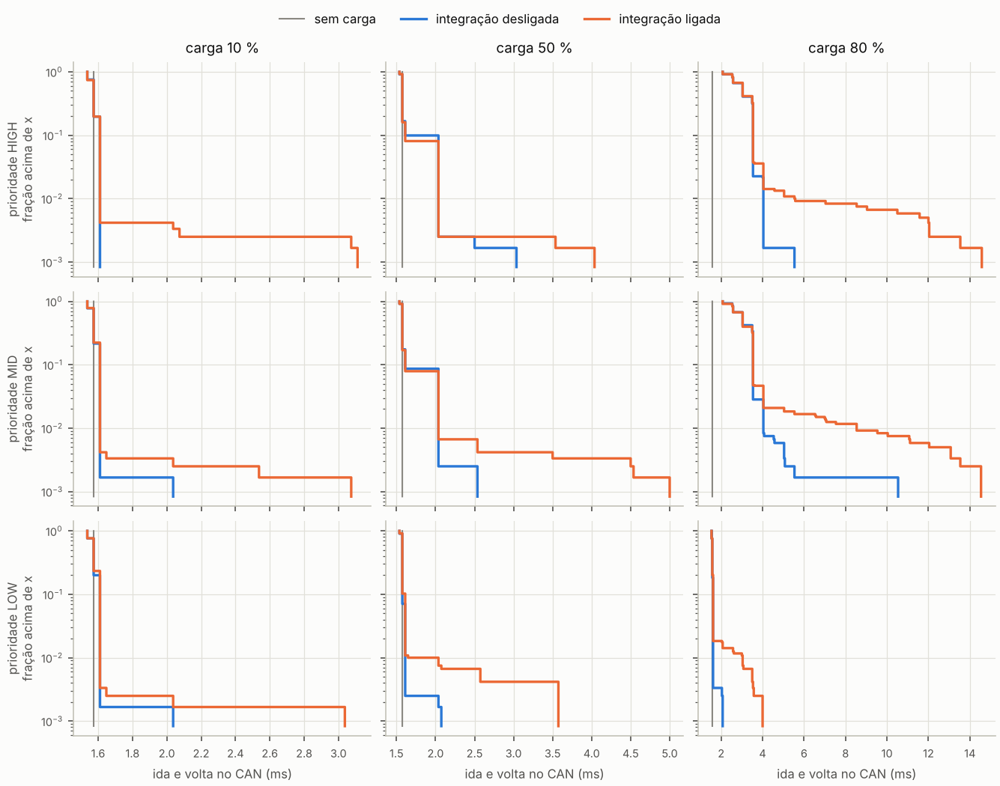
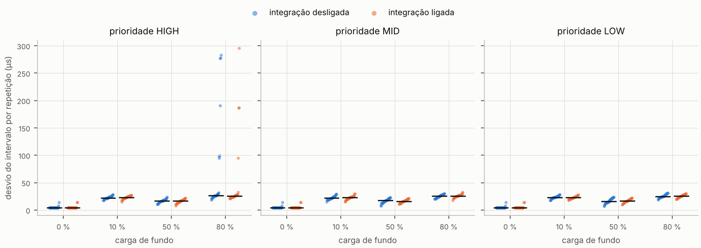

# Relatório da campanha `bancada_virtual`

Custo da integração sem fio autenticada sobre o tráfego CAN, em função da carga de fundo e da prioridade dela, e reação da rede a falhas. Bancada virtual: firmware real dos Nodes, sem modelo de CPU nem de rádio.

## Proveniência

- Bancada: **virtual**; desenho `sha256:b43a53811dfc3b6a`
- Código: commit `347eddb07448` (modelo-pesquisa)
- Fontes do firmware: `sha256:f320c5f2d88b5ce6`; Python 3.13.17
- Parâmetros da compilação informados pela Probe ([GW] CONFIG): `assoc_hysteresis_ms=0`, `assoc_lost_ms=45000`, `assoc_stale_ms=15000`, `bitrate=500000`, `fault_injection=1`, `follower_watchdog=1`, `hb_period_ms=1000`, `load_ids=0x010,0x1F0,0x7EF`, `node=0`, `offer_hold_ms=15000`, `ping_ms=3000`, `session_timeout_ms=10000`, `stream_period_ms=1000`
- Execuções: 840 completas de 840 planejadas; 0 com erro
- Amostragem do eco: POISSON; fase do início da janela sorteada por execução (`phase_ms`)
- Configuração idêntica entre as repetições de cada condição: sim
- Sequência de carga conferida pela semente: sim, em todas as condições com carga

## Ida e volta no barramento (eco), relógio da Probe

Média por repetição com IC 95 % entre repetições; percentis com todas as amostras juntas (ms).

| condição | LOCAL média [IC95] | LOCAL p50 | LOCAL p99 | LOCAL perda | SENSOR média [IC95] | SENSOR p99 | parte Wi-Fi média | parte CAN média |
|---|---|---|---|---|---|---|---|---|
| desempenho: iot=off,load_pct=0,load_prio=HIGH | 1.57 [1.57; 1.58] | 1.57 | 1.57 | 0.000 | 1.57 [1.57; 1.57] | 1.57 | 0.60 | 0.97 |
| desempenho: iot=off,load_pct=10,load_prio=HIGH | 1.57 [1.57; 1.57] | 1.57 | 1.61 | 0.000 | 1.57 [1.57; 1.57] | 1.61 | 0.60 | 0.97 |
| desempenho: iot=off,load_pct=10,load_prio=LOW | 1.57 [1.57; 1.58] | 1.57 | 1.61 | 0.000 | 1.57 [1.57; 1.57] | 1.61 | 0.60 | 0.97 |
| desempenho: iot=off,load_pct=10,load_prio=MID | 1.57 [1.57; 1.58] | 1.57 | 1.61 | 0.000 | 1.57 [1.57; 1.57] | 1.61 | 0.60 | 0.97 |
| desempenho: iot=off,load_pct=50,load_prio=HIGH | 1.62 [1.61; 1.63] | 1.57 | 2.04 | 0.000 | 1.61 [1.61; 1.62] | 2.04 | 0.60 | 1.01 |
| desempenho: iot=off,load_pct=50,load_prio=LOW | 1.57 [1.57; 1.58] | 1.57 | 1.61 | 0.000 | 1.58 [1.57; 1.58] | 1.61 | 0.60 | 0.98 |
| desempenho: iot=off,load_pct=50,load_prio=MID | 1.62 [1.61; 1.63] | 1.57 | 2.04 | 0.000 | 1.62 [1.61; 1.63] | 2.04 | 0.60 | 1.02 |
| desempenho: iot=off,load_pct=80,load_prio=HIGH | 3.05 [3.02; 3.08] | 3.04 | 4.04 | 0.000 | 3.05 [3.02; 3.08] | 4.04 | 0.60 | 2.45 |
| desempenho: iot=off,load_pct=80,load_prio=LOW | 1.57 [1.57; 1.58] | 1.57 | 1.61 | 0.000 | 1.58 [1.57; 1.58] | 1.61 | 0.60 | 0.98 |
| desempenho: iot=off,load_pct=80,load_prio=MID | 3.09 [3.04; 3.13] | 3.04 | 4.04 | 0.000 | 3.07 [3.04; 3.11] | 4.04 | 0.60 | 2.47 |
| desempenho: iot=on,load_pct=0,load_prio=HIGH | 1.58 [1.57; 1.58] | 1.57 | 1.57 | 0.000 | 1.58 [1.57; 1.58] | 1.57 | 0.60 | 0.98 |
| desempenho: iot=on,load_pct=10,load_prio=HIGH | 1.58 [1.57; 1.58] | 1.57 | 1.61 | 0.000 | 1.57 [1.57; 1.58] | 1.61 | 0.60 | 0.97 |
| desempenho: iot=on,load_pct=10,load_prio=LOW | 1.58 [1.57; 1.58] | 1.57 | 1.61 | 0.000 | 1.57 [1.57; 1.58] | 1.61 | 0.60 | 0.97 |
| desempenho: iot=on,load_pct=10,load_prio=MID | 1.58 [1.57; 1.58] | 1.57 | 1.61 | 0.000 | 1.58 [1.57; 1.58] | 1.61 | 0.60 | 0.98 |
| desempenho: iot=on,load_pct=50,load_prio=HIGH | 1.62 [1.61; 1.63] | 1.57 | 2.04 | 0.000 | 1.62 [1.61; 1.63] | 2.04 | 0.60 | 1.02 |
| desempenho: iot=on,load_pct=50,load_prio=LOW | 1.59 [1.58; 1.60] | 1.57 | 1.65 | 0.000 | 1.59 [1.58; 1.59] | 1.65 | 0.60 | 0.99 |
| desempenho: iot=on,load_pct=50,load_prio=MID | 1.62 [1.61; 1.64] | 1.57 | 2.04 | 0.000 | 1.61 [1.61; 1.62] | 2.04 | 0.60 | 1.01 |
| desempenho: iot=on,load_pct=80,load_prio=HIGH | 3.14 [3.07; 3.21] | 3.04 | 5.54 | 0.000 | 3.10 [3.05; 3.15] | 5.55 | 0.60 | 2.50 |
| desempenho: iot=on,load_pct=80,load_prio=LOW | 1.60 [1.59; 1.61] | 1.57 | 3.04 | 0.000 | 1.58 [1.58; 1.59] | 1.61 | 0.60 | 0.98 |
| desempenho: iot=on,load_pct=80,load_prio=MID | 3.17 [3.10; 3.24] | 3.04 | 8.54 | 0.000 | 3.12 [3.06; 3.18] | 5.55 | 0.60 | 2.52 |
| falhas: fault=ap_outage,load_pct=0 | — | — | — | — | — | — | — | — |
| falhas: fault=ap_outage,load_pct=50 | — | — | — | — | — | — | — | — |
| falhas: fault=drop_session,load_pct=0 | — | — | — | — | — | — | — | — |
| falhas: fault=drop_session,load_pct=50 | — | — | — | — | — | — | — | — |
| falhas: fault=owner_power,load_pct=0 | — | — | — | — | — | — | — | — |
| falhas: fault=owner_power,load_pct=50 | — | — | — | — | — | — | — | — |
| falhas: fault=sensor_off,load_pct=0 | — | — | — | — | — | — | — | — |
| falhas: fault=sensor_off,load_pct=50 | — | — | — | — | — | — | — | — |

## Sinal de presença do líder e telemetria

| condição | intervalo HB p50 (µs) | HB p99 (µs) | variação HB média (µs) | telemetria perda | amostras | ocupação média (%) | carga obtida (%) |
|---|---|---|---|---|---|---|---|
| desempenho: iot=off,load_pct=0,load_prio=HIGH | 1000000 | 1000000 | 5.2 | — | — | 0.19 | — |
| desempenho: iot=off,load_pct=10,load_prio=HIGH | 1000000 | 1000037 | 22.9 | — | — | 10.08 | 9.99 |
| desempenho: iot=off,load_pct=10,load_prio=LOW | 1000000 | 1000037 | 23.4 | — | — | 10.08 | 9.99 |
| desempenho: iot=off,load_pct=10,load_prio=MID | 1000000 | 1000037 | 22.3 | — | — | 10.10 | 9.99 |
| desempenho: iot=off,load_pct=50,load_prio=HIGH | 1000000 | 1000037 | 16.9 | — | — | 49.69 | 49.99 |
| desempenho: iot=off,load_pct=50,load_prio=LOW | 1000000 | 1000037 | 16.7 | — | — | 49.69 | 49.99 |
| desempenho: iot=off,load_pct=50,load_prio=MID | 1000000 | 1000037 | 16.8 | — | — | 49.63 | 49.99 |
| desempenho: iot=off,load_pct=80,load_prio=HIGH | 1000000 | 1000037 | 64.0 | — | — | 79.30 | 79.99 |
| desempenho: iot=off,load_pct=80,load_prio=LOW | 1000000 | 1000037 | 25.6 | — | — | 79.34 | 79.99 |
| desempenho: iot=off,load_pct=80,load_prio=MID | 1000000 | 1000037 | 25.3 | — | — | 79.40 | 79.99 |
| desempenho: iot=on,load_pct=0,load_prio=HIGH | 1000000 | 1000000 | 5.4 | 0.0000 | 1819 | 0.40 | — |
| desempenho: iot=on,load_pct=10,load_prio=HIGH | 1000000 | 1000037 | 22.9 | 0.0000 | 1816 | 10.30 | 9.99 |
| desempenho: iot=on,load_pct=10,load_prio=LOW | 1000000 | 1000037 | 22.8 | 0.0000 | 1819 | 10.32 | 9.99 |
| desempenho: iot=on,load_pct=10,load_prio=MID | 1000000 | 1000037 | 22.4 | 0.0000 | 1814 | 10.30 | 9.99 |
| desempenho: iot=on,load_pct=50,load_prio=HIGH | 1000000 | 1000037 | 16.3 | 0.0000 | 1816 | 49.93 | 49.99 |
| desempenho: iot=on,load_pct=50,load_prio=LOW | 1000000 | 1000037 | 16.9 | 0.0000 | 1814 | 49.86 | 49.99 |
| desempenho: iot=on,load_pct=50,load_prio=MID | 1000000 | 1000037 | 16.3 | 0.0000 | 1816 | 49.87 | 49.99 |
| desempenho: iot=on,load_pct=80,load_prio=HIGH | 1000000 | 1000037 | 47.4 | 0.0000 | 1811 | 79.48 | 79.99 |
| desempenho: iot=on,load_pct=80,load_prio=LOW | 1000000 | 1000037 | 25.4 | 0.0000 | 1818 | 79.63 | 79.99 |
| desempenho: iot=on,load_pct=80,load_prio=MID | 1000000 | 1000037 | 25.9 | 0.0000 | 1816 | 79.56 | 79.99 |
| falhas: fault=ap_outage,load_pct=0 | 1000000 | 1000000 | 4.8 | 0.0000 | 1830 | 0.21 | — |
| falhas: fault=ap_outage,load_pct=50 | 1000000 | 1000037 | 14.9 | 0.0000 | 1830 | 49.92 | 49.99 |
| falhas: fault=drop_session,load_pct=0 | 1000000 | 1000000 | 4.8 | 0.0000 | 3379 | 0.30 | — |
| falhas: fault=drop_session,load_pct=50 | 1000000 | 1000037 | 15.8 | 0.0000 | 3375 | 50.06 | 49.99 |
| falhas: fault=owner_power,load_pct=0 | 1000000 | 1000037 | 2828.3 | 0.0000 | 2862 | 0.26 | — |
| falhas: fault=owner_power,load_pct=50 | 1000000 | 1000037 | 3031.3 | 0.0000 | 2864 | 49.91 | 49.87 |
| falhas: fault=sensor_off,load_pct=0 | 1000000 | 1000000 | 4.8 | 0.0000 | 1770 | 0.19 | — |
| falhas: fault=sensor_off,load_pct=50 | 1000000 | 1000037 | 15.8 | 0.0000 | 1770 | 49.95 | 49.99 |

## Máquina de estados e recuperação (relógio de referência, ms)

Tempos contados a partir da falha (instante de referência), média entre repetições.

| condição | perda da sessão | STALE | LOST | decisão de reassociação | sessão restabelecida | telemetria interrompida | telemetria retomada | após o fim da causa | transições espúrias |
|---|---|---|---|---|---|---|---|---|---|
| desempenho: iot=off,load_pct=0,load_prio=HIGH | — | — | — | — | — | — | — | — | 0.00 |
| desempenho: iot=off,load_pct=10,load_prio=HIGH | — | — | — | — | — | — | — | — | 0.00 |
| desempenho: iot=off,load_pct=10,load_prio=LOW | — | — | — | — | — | — | — | — | 0.00 |
| desempenho: iot=off,load_pct=10,load_prio=MID | — | — | — | — | — | — | — | — | 0.00 |
| desempenho: iot=off,load_pct=50,load_prio=HIGH | — | — | — | — | — | — | — | — | 0.00 |
| desempenho: iot=off,load_pct=50,load_prio=LOW | — | — | — | — | — | — | — | — | 0.00 |
| desempenho: iot=off,load_pct=50,load_prio=MID | — | — | — | — | — | — | — | — | 0.00 |
| desempenho: iot=off,load_pct=80,load_prio=HIGH | — | — | — | — | — | — | — | — | 0.00 |
| desempenho: iot=off,load_pct=80,load_prio=LOW | — | — | — | — | — | — | — | — | 0.00 |
| desempenho: iot=off,load_pct=80,load_prio=MID | — | — | — | — | — | — | — | — | 0.00 |
| desempenho: iot=on,load_pct=0,load_prio=HIGH | — | — | — | — | — | — | — | — | 0.00 |
| desempenho: iot=on,load_pct=10,load_prio=HIGH | — | — | — | — | — | — | — | — | 0.00 |
| desempenho: iot=on,load_pct=10,load_prio=LOW | — | — | — | — | — | — | — | — | 0.00 |
| desempenho: iot=on,load_pct=10,load_prio=MID | — | — | — | — | — | — | — | — | 0.00 |
| desempenho: iot=on,load_pct=50,load_prio=HIGH | — | — | — | — | — | — | — | — | 0.00 |
| desempenho: iot=on,load_pct=50,load_prio=LOW | — | — | — | — | — | — | — | — | 0.00 |
| desempenho: iot=on,load_pct=50,load_prio=MID | — | — | — | — | — | — | — | — | 0.00 |
| desempenho: iot=on,load_pct=80,load_prio=HIGH | — | — | — | — | — | — | — | — | 0.00 |
| desempenho: iot=on,load_pct=80,load_prio=LOW | — | — | — | — | — | — | — | — | 0.00 |
| desempenho: iot=on,load_pct=80,load_prio=MID | — | — | — | — | — | — | — | — | 0.00 |
| falhas: fault=ap_outage,load_pct=0 | 1 | — | — | — | 60001 | 60664 | 60201 | 201 | — |
| falhas: fault=ap_outage,load_pct=50 | 1 | — | — | — | 60003 | 60730 | 60203 | 203 | — |
| falhas: fault=drop_session,load_pct=0 | 1 | — | — | — | 8175 | 8834 | 8375 | — | — |
| falhas: fault=drop_session,load_pct=50 | 2 | — | — | — | 8299 | 8968 | 8499 | — | — |
| falhas: fault=owner_power,load_pct=0 | 4493 | — | — | 4492 | 24996 | 25634 | 25196 | — | — |
| falhas: fault=owner_power,load_pct=50 | 4374 | — | — | 4372 | 25078 | 25767 | 25278 | — | — |
| falhas: fault=sensor_off,load_pct=0 | 9775 | 24775 | 54775 | — | 61502 | 62147 | 61702 | 1702 | — |
| falhas: fault=sensor_off,load_pct=50 | 9781 | 24782 | 54782 | — | 61503 | 62221 | 61704 | 1704 | — |

## Custo da criptografia e da ponte no Node (µs)

Na bancada virtual o tempo de CPU não é modelado: a criptografia não aparece aqui (os valores do CSV são artefato do relógio simulado). A ponte reflete só a espera na fila de transmissão do Node.

| condição | ponte Wi-Fi→CAN média | ponte p99 |
|---|---|---|
| desempenho: iot=on,load_pct=0,load_prio=HIGH | 1001 | 1372 |
| desempenho: iot=on,load_pct=10,load_prio=HIGH | 1204 | 1500 |
| desempenho: iot=on,load_pct=10,load_prio=LOW | 1001 | 1000 |
| desempenho: iot=on,load_pct=10,load_prio=MID | 1207 | 1500 |
| desempenho: iot=on,load_pct=50,load_prio=HIGH | 2143 | 3000 |
| desempenho: iot=on,load_pct=50,load_prio=LOW | 1080 | 1500 |
| desempenho: iot=on,load_pct=50,load_prio=MID | 2154 | 3000 |
| desempenho: iot=on,load_pct=80,load_prio=HIGH | 5674 | 8780 |
| desempenho: iot=on,load_pct=80,load_prio=LOW | 1446 | 1500 |
| desempenho: iot=on,load_pct=80,load_prio=MID | 5625 | 8000 |
| falhas: fault=ap_outage,load_pct=0 | 1000 | 1000 |
| falhas: fault=ap_outage,load_pct=50 | 2131 | 2500 |
| falhas: fault=drop_session,load_pct=0 | 1000 | 1000 |
| falhas: fault=drop_session,load_pct=50 | 2133 | 2500 |
| falhas: fault=owner_power,load_pct=0 | 1001 | 1055 |
| falhas: fault=owner_power,load_pct=50 | 2004 | 2665 |
| falhas: fault=sensor_off,load_pct=0 | 1000 | 1000 |
| falhas: fault=sensor_off,load_pct=50 | 2129 | 2500 |

## Comparações (unidade: repetição)

| condição | contra | métrica | média ref. | média | g de Hedges [IC95] | delta de Cliff | p (MW, Holm) |
|---|---|---|---|---|---|---|---|
| iot=on,load_pct=0,load_prio=HIGH | iot=off,load_pct=0,load_prio=HIGH | eco_local_media_us | 1574.8 | 1576.6 | 0.27 [-0.24; 0.78] | 0.13 (desprezível) | 1.0000 |
| iot=on,load_pct=0,load_prio=HIGH | iot=off,load_pct=0,load_prio=HIGH | eco_local_p99_us | 1593.6 | 1637.3 | 0.27 [-0.24; 0.78] | 0.13 (desprezível) | 0.4831 |
| iot=on,load_pct=0,load_prio=HIGH | iot=off,load_pct=0,load_prio=HIGH | eco_sensor_media_us | 1574.0 | 1578.1 | 0.43 [-0.08; 0.94] | 0.13 (desprezível) | 0.7127 |
| iot=on,load_pct=0,load_prio=HIGH | iot=off,load_pct=0,load_prio=HIGH | eco_can_media_us | 974.0 | 978.3 | 0.44 [-0.07; 0.96] | 0.17 (pequeno) | 0.3884 |
| iot=on,load_pct=0,load_prio=HIGH | iot=off,load_pct=0,load_prio=HIGH | hb_jitter_us | 5.2 | 5.4 | 0.09 [-0.41; 0.60] | -0.09 (desprezível) | 1.0000 |
| iot=on,load_pct=10,load_prio=HIGH | iot=off,load_pct=10,load_prio=HIGH | eco_local_media_us | 1572.2 | 1576.5 | 0.44 [-0.08; 0.95] | 0.09 (desprezível) | 1.0000 |
| iot=on,load_pct=10,load_prio=HIGH | iot=off,load_pct=10,load_prio=HIGH | eco_local_p99_us | 1611.0 | 1726.1 | 0.51 [-0.00; 1.02] | 0.13 (desprezível) | 0.2516 |
| iot=on,load_pct=10,load_prio=HIGH | iot=off,load_pct=10,load_prio=HIGH | eco_sensor_media_us | 1573.0 | 1574.8 | 0.22 [-0.29; 0.73] | -0.01 (desprezível) | 1.0000 |
| iot=on,load_pct=10,load_prio=HIGH | iot=off,load_pct=10,load_prio=HIGH | eco_can_media_us | 973.1 | 975.0 | 0.22 [-0.29; 0.72] | -0.01 (desprezível) | 1.0000 |
| iot=on,load_pct=10,load_prio=HIGH | iot=off,load_pct=10,load_prio=HIGH | hb_jitter_us | 22.9 | 22.9 | 0.02 [-0.49; 0.52] | 0.05 (desprezível) | 1.0000 |
| iot=on,load_pct=10,load_prio=LOW | iot=off,load_pct=10,load_prio=LOW | eco_local_media_us | 1573.4 | 1576.7 | 0.41 [-0.10; 0.92] | 0.19 (pequeno) | 1.0000 |
| iot=on,load_pct=10,load_prio=LOW | iot=off,load_pct=10,load_prio=LOW | eco_local_p99_us | 1629.8 | 1678.4 | 0.29 [-0.22; 0.80] | 0.07 (desprezível) | 1.0000 |
| iot=on,load_pct=10,load_prio=LOW | iot=off,load_pct=10,load_prio=LOW | eco_sensor_media_us | 1573.3 | 1574.0 | 0.11 [-0.40; 0.62] | -0.07 (desprezível) | 1.0000 |
| iot=on,load_pct=10,load_prio=LOW | iot=off,load_pct=10,load_prio=LOW | eco_can_media_us | 973.3 | 974.0 | 0.11 [-0.40; 0.62] | -0.07 (desprezível) | 1.0000 |
| iot=on,load_pct=10,load_prio=LOW | iot=off,load_pct=10,load_prio=LOW | hb_jitter_us | 23.4 | 22.8 | -0.21 [-0.72; 0.30] | -0.13 (desprezível) | 1.0000 |
| iot=on,load_pct=10,load_prio=MID | iot=off,load_pct=10,load_prio=MID | eco_local_media_us | 1574.5 | 1578.3 | 0.42 [-0.09; 0.93] | 0.18 (pequeno) | 1.0000 |
| iot=on,load_pct=10,load_prio=MID | iot=off,load_pct=10,load_prio=MID | eco_local_p99_us | 1628.3 | 1708.2 | 0.39 [-0.12; 0.90] | 0.10 (desprezível) | 0.8698 |
| iot=on,load_pct=10,load_prio=MID | iot=off,load_pct=10,load_prio=MID | eco_sensor_media_us | 1572.7 | 1577.5 | 0.48 [-0.03; 0.99] | 0.15 (pequeno) | 1.0000 |
| iot=on,load_pct=10,load_prio=MID | iot=off,load_pct=10,load_prio=MID | eco_can_media_us | 973.0 | 977.7 | 0.46 [-0.06; 0.97] | 0.13 (desprezível) | 1.0000 |
| iot=on,load_pct=10,load_prio=MID | iot=off,load_pct=10,load_prio=MID | hb_jitter_us | 22.3 | 22.4 | 0.04 [-0.47; 0.54] | 0.05 (desprezível) | 1.0000 |
| iot=on,load_pct=50,load_prio=HIGH | iot=off,load_pct=50,load_prio=HIGH | eco_local_media_us | 1621.2 | 1616.1 | -0.19 [-0.70; 0.31] | -0.06 (desprezível) | 1.0000 |
| iot=on,load_pct=50,load_prio=HIGH | iot=off,load_pct=50,load_prio=HIGH | eco_local_p99_us | 2059.4 | 2109.4 | 0.17 [-0.34; 0.67] | 0.03 (desprezível) | 1.0000 |
| iot=on,load_pct=50,load_prio=HIGH | iot=off,load_pct=50,load_prio=HIGH | eco_sensor_media_us | 1614.2 | 1623.3 | 0.36 [-0.15; 0.87] | 0.20 (pequeno) | 1.0000 |
| iot=on,load_pct=50,load_prio=HIGH | iot=off,load_pct=50,load_prio=HIGH | eco_can_media_us | 1014.4 | 1023.3 | 0.36 [-0.15; 0.87] | 0.20 (pequeno) | 1.0000 |
| iot=on,load_pct=50,load_prio=HIGH | iot=off,load_pct=50,load_prio=HIGH | hb_jitter_us | 16.9 | 16.3 | -0.17 [-0.67; 0.34] | -0.07 (desprezível) | 1.0000 |
| iot=on,load_pct=50,load_prio=LOW | iot=off,load_pct=50,load_prio=LOW | eco_local_media_us | 1574.6 | 1587.1 | 0.74 [0.22; 1.27] | 0.50 (grande) | 0.0168 |
| iot=on,load_pct=50,load_prio=LOW | iot=off,load_pct=50,load_prio=LOW | eco_local_p99_us | 1643.8 | 1904.5 | 0.68 [0.16; 1.20] | 0.37 (médio) | 0.0331 |
| iot=on,load_pct=50,load_prio=LOW | iot=off,load_pct=50,load_prio=LOW | eco_sensor_media_us | 1577.2 | 1586.2 | 0.52 [0.00; 1.03] | 0.12 (desprezível) | 1.0000 |
| iot=on,load_pct=50,load_prio=LOW | iot=off,load_pct=50,load_prio=LOW | eco_can_media_us | 977.4 | 986.5 | 0.52 [0.00; 1.03] | 0.10 (desprezível) | 1.0000 |
| iot=on,load_pct=50,load_prio=LOW | iot=off,load_pct=50,load_prio=LOW | hb_jitter_us | 16.7 | 16.9 | 0.04 [-0.46; 0.55] | 0.02 (desprezível) | 1.0000 |
| iot=on,load_pct=50,load_prio=MID | iot=off,load_pct=50,load_prio=MID | eco_local_media_us | 1617.6 | 1622.8 | 0.15 [-0.35; 0.66] | -0.03 (desprezível) | 1.0000 |
| iot=on,load_pct=50,load_prio=MID | iot=off,load_pct=50,load_prio=MID | eco_local_p99_us | 2090.6 | 2260.7 | 0.31 [-0.20; 0.82] | 0.03 (desprezível) | 1.0000 |
| iot=on,load_pct=50,load_prio=MID | iot=off,load_pct=50,load_prio=MID | eco_sensor_media_us | 1617.8 | 1613.4 | -0.21 [-0.72; 0.30] | -0.09 (desprezível) | 1.0000 |
| iot=on,load_pct=50,load_prio=MID | iot=off,load_pct=50,load_prio=MID | eco_can_media_us | 1017.9 | 1013.5 | -0.21 [-0.72; 0.30] | -0.09 (desprezível) | 1.0000 |
| iot=on,load_pct=50,load_prio=MID | iot=off,load_pct=50,load_prio=MID | hb_jitter_us | 16.8 | 16.3 | -0.12 [-0.63; 0.38] | -0.09 (desprezível) | 1.0000 |
| iot=on,load_pct=80,load_prio=HIGH | iot=off,load_pct=80,load_prio=HIGH | eco_local_media_us | 3051.8 | 3136.0 | 0.57 [0.05; 1.09] | 0.20 (pequeno) | 1.0000 |
| iot=on,load_pct=80,load_prio=HIGH | iot=off,load_pct=80,load_prio=HIGH | eco_local_p99_us | 3843.2 | 5482.8 | 0.75 [0.23; 1.28] | 0.43 (médio) | 0.0249 |
| iot=on,load_pct=80,load_prio=HIGH | iot=off,load_pct=80,load_prio=HIGH | eco_sensor_media_us | 3048.4 | 3103.4 | 0.47 [-0.04; 0.98] | 0.21 (pequeno) | 1.0000 |
| iot=on,load_pct=80,load_prio=HIGH | iot=off,load_pct=80,load_prio=HIGH | eco_can_media_us | 2448.4 | 2503.6 | 0.47 [-0.04; 0.98] | 0.21 (pequeno) | 1.0000 |
| iot=on,load_pct=80,load_prio=HIGH | iot=off,load_pct=80,load_prio=HIGH | hb_jitter_us | 64.0 | 47.4 | -0.22 [-0.73; 0.28] | -0.20 (pequeno) | 1.0000 |
| iot=on,load_pct=80,load_prio=LOW | iot=off,load_pct=80,load_prio=LOW | eco_local_media_us | 1573.3 | 1598.0 | 1.02 [0.48; 1.55] | 0.44 (médio) | 0.0667 |
| iot=on,load_pct=80,load_prio=LOW | iot=off,load_pct=80,load_prio=LOW | eco_local_p99_us | 1647.9 | 2169.2 | 1.08 [0.54; 1.62] | 0.46 (médio) | 0.0026 |
| iot=on,load_pct=80,load_prio=LOW | iot=off,load_pct=80,load_prio=LOW | eco_sensor_media_us | 1576.0 | 1583.3 | 0.46 [-0.05; 0.97] | 0.20 (pequeno) | 1.0000 |
| iot=on,load_pct=80,load_prio=LOW | iot=off,load_pct=80,load_prio=LOW | eco_can_media_us | 976.2 | 983.3 | 0.45 [-0.06; 0.96] | 0.19 (pequeno) | 1.0000 |
| iot=on,load_pct=80,load_prio=LOW | iot=off,load_pct=80,load_prio=LOW | hb_jitter_us | 25.6 | 25.4 | -0.07 [-0.57; 0.44] | -0.03 (desprezível) | 1.0000 |
| iot=on,load_pct=80,load_prio=MID | iot=off,load_pct=80,load_prio=MID | eco_local_media_us | 3085.2 | 3167.7 | 0.52 [0.00; 1.03] | 0.29 (pequeno) | 0.7343 |
| iot=on,load_pct=80,load_prio=MID | iot=off,load_pct=80,load_prio=MID | eco_local_p99_us | 4197.6 | 6276.3 | 0.93 [0.40; 1.46] | 0.52 (grande) | 0.0043 |
| iot=on,load_pct=80,load_prio=MID | iot=off,load_pct=80,load_prio=MID | eco_sensor_media_us | 3074.4 | 3117.2 | 0.32 [-0.18; 0.83] | 0.19 (pequeno) | 1.0000 |
| iot=on,load_pct=80,load_prio=MID | iot=off,load_pct=80,load_prio=MID | eco_can_media_us | 2474.4 | 2517.4 | 0.33 [-0.18; 0.83] | 0.19 (pequeno) | 1.0000 |
| iot=on,load_pct=80,load_prio=MID | iot=off,load_pct=80,load_prio=MID | hb_jitter_us | 25.3 | 25.9 | 0.20 [-0.31; 0.71] | 0.10 (desprezível) | 1.0000 |
| iot=off,load_pct=10,load_prio=HIGH | iot=off,load_pct=0,load_prio=HIGH | eco_local_media_us | 1574.8 | 1572.2 | -0.58 [-1.09; -0.06] | -0.45 (médio) | 0.0252 |
| iot=off,load_pct=10,load_prio=HIGH | iot=off,load_pct=0,load_prio=HIGH | eco_local_p99_us | 1593.6 | 1611.0 | 0.23 [-0.28; 0.73] | 0.93 (grande) | 0.0000 |
| iot=off,load_pct=10,load_prio=HIGH | iot=off,load_pct=0,load_prio=HIGH | eco_sensor_media_us | 1574.0 | 1573.0 | -0.39 [-0.91; 0.12] | -0.27 (pequeno) | 0.8101 |
| iot=off,load_pct=10,load_prio=HIGH | iot=off,load_pct=0,load_prio=HIGH | eco_can_media_us | 974.0 | 973.1 | -0.31 [-0.82; 0.20] | -0.23 (pequeno) | 1.0000 |
| iot=off,load_pct=10,load_prio=HIGH | iot=off,load_pct=0,load_prio=HIGH | hb_jitter_us | 5.2 | 22.9 | 7.43 [6.01; 8.85] | 1.00 (grande) | 0.0000 |
| iot=off,load_pct=10,load_prio=LOW | iot=off,load_pct=0,load_prio=HIGH | eco_local_media_us | 1574.8 | 1573.4 | -0.31 [-0.82; 0.20] | -0.32 (pequeno) | 0.3059 |
| iot=off,load_pct=10,load_prio=LOW | iot=off,load_pct=0,load_prio=HIGH | eco_local_p99_us | 1593.6 | 1629.8 | 0.39 [-0.12; 0.90] | 0.93 (grande) | 0.0000 |
| iot=off,load_pct=10,load_prio=LOW | iot=off,load_pct=0,load_prio=HIGH | eco_sensor_media_us | 1574.0 | 1573.3 | -0.23 [-0.73; 0.28] | -0.07 (desprezível) | 1.0000 |
| iot=off,load_pct=10,load_prio=LOW | iot=off,load_pct=0,load_prio=HIGH | eco_can_media_us | 974.0 | 973.3 | -0.23 [-0.73; 0.28] | -0.07 (desprezível) | 1.0000 |
| iot=off,load_pct=10,load_prio=LOW | iot=off,load_pct=0,load_prio=HIGH | hb_jitter_us | 5.2 | 23.4 | 7.63 [6.18; 9.09] | 1.00 (grande) | 0.0000 |
| iot=off,load_pct=10,load_prio=MID | iot=off,load_pct=0,load_prio=HIGH | eco_local_media_us | 1574.8 | 1574.5 | -0.07 [-0.58; 0.43] | -0.16 (pequeno) | 1.0000 |
| iot=off,load_pct=10,load_prio=MID | iot=off,load_pct=0,load_prio=HIGH | eco_local_p99_us | 1593.6 | 1628.3 | 0.39 [-0.13; 0.90] | 0.93 (grande) | 0.0000 |
| iot=off,load_pct=10,load_prio=MID | iot=off,load_pct=0,load_prio=HIGH | eco_sensor_media_us | 1574.0 | 1572.7 | -0.62 [-1.14; -0.10] | -0.37 (médio) | 0.1458 |
| iot=off,load_pct=10,load_prio=MID | iot=off,load_pct=0,load_prio=HIGH | eco_can_media_us | 974.0 | 973.0 | -0.44 [-0.95; 0.08] | -0.23 (pequeno) | 1.0000 |
| iot=off,load_pct=10,load_prio=MID | iot=off,load_pct=0,load_prio=HIGH | hb_jitter_us | 5.2 | 22.3 | 6.02 [4.83; 7.21] | 1.00 (grande) | 0.0000 |
| iot=off,load_pct=50,load_prio=HIGH | iot=off,load_pct=0,load_prio=HIGH | eco_local_media_us | 1574.8 | 1621.2 | 2.26 [1.62; 2.91] | 0.98 (grande) | 0.0000 |
| iot=off,load_pct=50,load_prio=HIGH | iot=off,load_pct=0,load_prio=HIGH | eco_local_p99_us | 1593.6 | 2059.4 | 3.09 [2.34; 3.84] | 0.94 (grande) | 0.0000 |
| iot=off,load_pct=50,load_prio=HIGH | iot=off,load_pct=0,load_prio=HIGH | eco_sensor_media_us | 1574.0 | 1614.2 | 2.44 [1.77; 3.11] | 1.00 (grande) | 0.0000 |
| iot=off,load_pct=50,load_prio=HIGH | iot=off,load_pct=0,load_prio=HIGH | eco_can_media_us | 974.0 | 1014.4 | 2.46 [1.79; 3.13] | 1.00 (grande) | 0.0000 |
| iot=off,load_pct=50,load_prio=HIGH | iot=off,load_pct=0,load_prio=HIGH | hb_jitter_us | 5.2 | 16.9 | 4.38 [3.45; 5.31] | 0.98 (grande) | 0.0000 |
| iot=off,load_pct=50,load_prio=LOW | iot=off,load_pct=0,load_prio=HIGH | eco_local_media_us | 1574.8 | 1574.6 | -0.04 [-0.54; 0.47] | -0.26 (pequeno) | 0.7462 |
| iot=off,load_pct=50,load_prio=LOW | iot=off,load_pct=0,load_prio=HIGH | eco_local_p99_us | 1593.6 | 1643.8 | 0.42 [-0.09; 0.93] | 0.87 (grande) | 0.0000 |
| iot=off,load_pct=50,load_prio=LOW | iot=off,load_pct=0,load_prio=HIGH | eco_sensor_media_us | 1574.0 | 1577.2 | 0.53 [0.02; 1.05] | 0.23 (pequeno) | 1.0000 |
| iot=off,load_pct=50,load_prio=LOW | iot=off,load_pct=0,load_prio=HIGH | eco_can_media_us | 974.0 | 977.4 | 0.58 [0.06; 1.10] | 0.30 (pequeno) | 0.4990 |
| iot=off,load_pct=50,load_prio=LOW | iot=off,load_pct=0,load_prio=HIGH | hb_jitter_us | 5.2 | 16.7 | 3.26 [2.49; 4.03] | 0.98 (grande) | 0.0000 |
| iot=off,load_pct=50,load_prio=MID | iot=off,load_pct=0,load_prio=HIGH | eco_local_media_us | 1574.8 | 1617.6 | 2.48 [1.81; 3.16] | 0.98 (grande) | 0.0000 |
| iot=off,load_pct=50,load_prio=MID | iot=off,load_pct=0,load_prio=HIGH | eco_local_p99_us | 1593.6 | 2090.6 | 1.89 [1.28; 2.50] | 0.94 (grande) | 0.0000 |
| iot=off,load_pct=50,load_prio=MID | iot=off,load_pct=0,load_prio=HIGH | eco_sensor_media_us | 1574.0 | 1617.8 | 2.93 [2.20; 3.66] | 1.00 (grande) | 0.0000 |
| iot=off,load_pct=50,load_prio=MID | iot=off,load_pct=0,load_prio=HIGH | eco_can_media_us | 974.0 | 1017.9 | 2.93 [2.21; 3.66] | 1.00 (grande) | 0.0000 |
| iot=off,load_pct=50,load_prio=MID | iot=off,load_pct=0,load_prio=HIGH | hb_jitter_us | 5.2 | 16.8 | 3.75 [2.91; 4.59] | 0.98 (grande) | 0.0000 |
| iot=off,load_pct=80,load_prio=HIGH | iot=off,load_pct=0,load_prio=HIGH | eco_local_media_us | 1574.8 | 3051.8 | 25.41 [20.84; 29.98] | 1.00 (grande) | 0.0000 |
| iot=off,load_pct=80,load_prio=HIGH | iot=off,load_pct=0,load_prio=HIGH | eco_local_p99_us | 1593.6 | 3843.2 | 5.38 [4.29; 6.47] | 1.00 (grande) | 0.0000 |
| iot=off,load_pct=80,load_prio=HIGH | iot=off,load_pct=0,load_prio=HIGH | eco_sensor_media_us | 1574.0 | 3048.4 | 23.30 [19.10; 27.50] | 1.00 (grande) | 0.0000 |
| iot=off,load_pct=80,load_prio=HIGH | iot=off,load_pct=0,load_prio=HIGH | eco_can_media_us | 974.0 | 2448.4 | 23.32 [19.12; 27.52] | 1.00 (grande) | 0.0000 |
| iot=off,load_pct=80,load_prio=HIGH | iot=off,load_pct=0,load_prio=HIGH | hb_jitter_us | 5.2 | 64.0 | 1.01 [0.47; 1.54] | 1.00 (grande) | 0.0000 |
| iot=off,load_pct=80,load_prio=LOW | iot=off,load_pct=0,load_prio=HIGH | eco_local_media_us | 1574.8 | 1573.3 | -0.29 [-0.80; 0.22] | -0.32 (pequeno) | 0.2985 |
| iot=off,load_pct=80,load_prio=LOW | iot=off,load_pct=0,load_prio=HIGH | eco_local_p99_us | 1593.6 | 1647.9 | 0.53 [0.01; 1.04] | 0.93 (grande) | 0.0000 |
| iot=off,load_pct=80,load_prio=LOW | iot=off,load_pct=0,load_prio=HIGH | eco_sensor_media_us | 1574.0 | 1576.0 | 0.24 [-0.27; 0.75] | -0.03 (desprezível) | 1.0000 |
| iot=off,load_pct=80,load_prio=LOW | iot=off,load_pct=0,load_prio=HIGH | eco_can_media_us | 974.0 | 976.2 | 0.26 [-0.25; 0.76] | 0.03 (desprezível) | 1.0000 |
| iot=off,load_pct=80,load_prio=LOW | iot=off,load_pct=0,load_prio=HIGH | hb_jitter_us | 5.2 | 25.6 | 7.48 [6.05; 8.91] | 1.00 (grande) | 0.0000 |
| iot=off,load_pct=80,load_prio=MID | iot=off,load_pct=0,load_prio=HIGH | eco_local_media_us | 1574.8 | 3085.2 | 17.04 [13.95; 20.14] | 1.00 (grande) | 0.0000 |
| iot=off,load_pct=80,load_prio=MID | iot=off,load_pct=0,load_prio=HIGH | eco_local_p99_us | 1593.6 | 4197.6 | 3.29 [2.52; 4.07] | 1.00 (grande) | 0.0000 |
| iot=off,load_pct=80,load_prio=MID | iot=off,load_pct=0,load_prio=HIGH | eco_sensor_media_us | 1574.0 | 3074.4 | 22.66 [18.58; 26.75] | 1.00 (grande) | 0.0000 |
| iot=off,load_pct=80,load_prio=MID | iot=off,load_pct=0,load_prio=HIGH | eco_can_media_us | 974.0 | 2474.4 | 22.66 [18.58; 26.75] | 1.00 (grande) | 0.0000 |
| iot=off,load_pct=80,load_prio=MID | iot=off,load_pct=0,load_prio=HIGH | hb_jitter_us | 5.2 | 25.3 | 7.72 [6.25; 9.19] | 1.00 (grande) | 0.0000 |
| iot=on,load_pct=10,load_prio=HIGH | iot=on,load_pct=0,load_prio=HIGH | eco_local_media_us | 1576.6 | 1576.5 | -0.01 [-0.51; 0.50] | -0.40 (médio) | 0.0903 |
| iot=on,load_pct=10,load_prio=HIGH | iot=on,load_pct=0,load_prio=HIGH | eco_local_p99_us | 1637.3 | 1726.1 | 0.33 [-0.18; 0.84] | 0.71 (grande) | 0.0000 |
| iot=on,load_pct=10,load_prio=HIGH | iot=on,load_pct=0,load_prio=HIGH | eco_sensor_media_us | 1578.1 | 1574.8 | -0.27 [-0.78; 0.24] | -0.43 (médio) | 0.0461 |
| iot=on,load_pct=10,load_prio=HIGH | iot=on,load_pct=0,load_prio=HIGH | eco_can_media_us | 978.3 | 975.0 | -0.27 [-0.78; 0.24] | -0.44 (médio) | 0.0421 |
| iot=on,load_pct=10,load_prio=HIGH | iot=on,load_pct=0,load_prio=HIGH | hb_jitter_us | 5.4 | 22.9 | 6.36 [5.12; 7.61] | 1.00 (grande) | 0.0000 |
| iot=on,load_pct=10,load_prio=HIGH | iot=on,load_pct=0,load_prio=HIGH | tel_intervalo_p99_us | 1000048.6 | 1000454.3 | 6.51 [5.24; 7.78] | 1.00 (grande) | 0.0000 |
| iot=on,load_pct=10,load_prio=HIGH | iot=on,load_pct=0,load_prio=HIGH | tel_perda | 0.0 | 0.0 | 0.00 [—; —] | 0.00 (desprezível) | 1.0000 |
| iot=on,load_pct=10,load_prio=HIGH | iot=on,load_pct=0,load_prio=HIGH | ponte_media_us | 1001.4 | 1203.9 | 7.70 [6.23; 9.17] | 1.00 (grande) | 0.0000 |
| iot=on,load_pct=10,load_prio=LOW | iot=on,load_pct=0,load_prio=HIGH | eco_local_media_us | 1576.6 | 1576.7 | 0.01 [-0.49; 0.52] | -0.17 (pequeno) | 1.0000 |
| iot=on,load_pct=10,load_prio=LOW | iot=on,load_pct=0,load_prio=HIGH | eco_local_p99_us | 1637.3 | 1678.4 | 0.19 [-0.32; 0.70] | 0.69 (grande) | 0.0000 |
| iot=on,load_pct=10,load_prio=LOW | iot=on,load_pct=0,load_prio=HIGH | eco_sensor_media_us | 1578.1 | 1574.0 | -0.38 [-0.89; 0.13] | -0.32 (pequeno) | 0.4487 |
| iot=on,load_pct=10,load_prio=LOW | iot=on,load_pct=0,load_prio=HIGH | eco_can_media_us | 978.3 | 974.0 | -0.39 [-0.90; 0.12] | -0.34 (médio) | 0.3456 |
| iot=on,load_pct=10,load_prio=LOW | iot=on,load_pct=0,load_prio=HIGH | hb_jitter_us | 5.4 | 22.8 | 6.84 [5.52; 8.16] | 1.00 (grande) | 0.0000 |
| iot=on,load_pct=10,load_prio=LOW | iot=on,load_pct=0,load_prio=HIGH | tel_intervalo_p99_us | 1000048.6 | 1000049.8 | 0.02 [-0.49; 0.52] | 0.56 (grande) | 0.0003 |
| iot=on,load_pct=10,load_prio=LOW | iot=on,load_pct=0,load_prio=HIGH | tel_perda | 0.0 | 0.0 | 0.00 [—; —] | 0.00 (desprezível) | 1.0000 |
| iot=on,load_pct=10,load_prio=LOW | iot=on,load_pct=0,load_prio=HIGH | ponte_media_us | 1001.4 | 1000.6 | -0.27 [-0.77; 0.24] | -0.07 (desprezível) | 0.3859 |
| iot=on,load_pct=10,load_prio=MID | iot=on,load_pct=0,load_prio=HIGH | eco_local_media_us | 1576.6 | 1578.3 | 0.16 [-0.34; 0.67] | -0.01 (desprezível) | 1.0000 |
| iot=on,load_pct=10,load_prio=MID | iot=on,load_pct=0,load_prio=HIGH | eco_local_p99_us | 1637.3 | 1708.2 | 0.29 [-0.22; 0.80] | 0.71 (grande) | 0.0000 |
| iot=on,load_pct=10,load_prio=MID | iot=on,load_pct=0,load_prio=HIGH | eco_sensor_media_us | 1578.1 | 1577.5 | -0.05 [-0.55; 0.46] | -0.17 (pequeno) | 1.0000 |
| iot=on,load_pct=10,load_prio=MID | iot=on,load_pct=0,load_prio=HIGH | eco_can_media_us | 978.3 | 977.7 | -0.04 [-0.55; 0.47] | -0.18 (pequeno) | 1.0000 |
| iot=on,load_pct=10,load_prio=MID | iot=on,load_pct=0,load_prio=HIGH | hb_jitter_us | 5.4 | 22.4 | 5.56 [4.44; 6.68] | 1.00 (grande) | 0.0000 |
| iot=on,load_pct=10,load_prio=MID | iot=on,load_pct=0,load_prio=HIGH | tel_intervalo_p99_us | 1000048.6 | 1000464.2 | 6.16 [4.95; 7.38] | 1.00 (grande) | 0.0000 |
| iot=on,load_pct=10,load_prio=MID | iot=on,load_pct=0,load_prio=HIGH | tel_perda | 0.0 | 0.0 | 0.00 [—; —] | 0.00 (desprezível) | 1.0000 |
| iot=on,load_pct=10,load_prio=MID | iot=on,load_pct=0,load_prio=HIGH | ponte_media_us | 1001.4 | 1207.4 | 8.20 [6.65; 9.75] | 1.00 (grande) | 0.0000 |
| iot=on,load_pct=50,load_prio=HIGH | iot=on,load_pct=0,load_prio=HIGH | eco_local_media_us | 1576.6 | 1616.1 | 2.14 [1.50; 2.77] | 0.88 (grande) | 0.0000 |
| iot=on,load_pct=50,load_prio=HIGH | iot=on,load_pct=0,load_prio=HIGH | eco_local_p99_us | 1637.3 | 2109.4 | 1.55 [0.97; 2.13] | 0.86 (grande) | 0.0000 |
| iot=on,load_pct=50,load_prio=HIGH | iot=on,load_pct=0,load_prio=HIGH | eco_sensor_media_us | 1578.1 | 1623.3 | 2.13 [1.50; 2.77] | 0.92 (grande) | 0.0000 |
| iot=on,load_pct=50,load_prio=HIGH | iot=on,load_pct=0,load_prio=HIGH | eco_can_media_us | 978.3 | 1023.3 | 2.12 [1.49; 2.75] | 0.91 (grande) | 0.0000 |
| iot=on,load_pct=50,load_prio=HIGH | iot=on,load_pct=0,load_prio=HIGH | hb_jitter_us | 5.4 | 16.3 | 3.63 [2.81; 4.46] | 0.96 (grande) | 0.0000 |
| iot=on,load_pct=50,load_prio=HIGH | iot=on,load_pct=0,load_prio=HIGH | tel_intervalo_p99_us | 1000048.6 | 1000568.4 | 4.57 [3.61; 5.53] | 1.00 (grande) | 0.0000 |
| iot=on,load_pct=50,load_prio=HIGH | iot=on,load_pct=0,load_prio=HIGH | tel_perda | 0.0 | 0.0 | 0.00 [—; —] | 0.00 (desprezível) | 1.0000 |
| iot=on,load_pct=50,load_prio=HIGH | iot=on,load_pct=0,load_prio=HIGH | ponte_media_us | 1001.4 | 2142.9 | 36.82 [30.22; 43.43] | 1.00 (grande) | 0.0000 |
| iot=on,load_pct=50,load_prio=LOW | iot=on,load_pct=0,load_prio=HIGH | eco_local_media_us | 1576.6 | 1587.1 | 0.61 [0.09; 1.12] | 0.37 (médio) | 0.1739 |
| iot=on,load_pct=50,load_prio=LOW | iot=on,load_pct=0,load_prio=HIGH | eco_local_p99_us | 1637.3 | 1904.5 | 0.67 [0.15; 1.19] | 0.76 (grande) | 0.0000 |
| iot=on,load_pct=50,load_prio=LOW | iot=on,load_pct=0,load_prio=HIGH | eco_sensor_media_us | 1578.1 | 1586.2 | 0.42 [-0.09; 0.94] | 0.12 (desprezível) | 1.0000 |
| iot=on,load_pct=50,load_prio=LOW | iot=on,load_pct=0,load_prio=HIGH | eco_can_media_us | 978.3 | 986.5 | 0.43 [-0.08; 0.94] | 0.11 (desprezível) | 1.0000 |
| iot=on,load_pct=50,load_prio=LOW | iot=on,load_pct=0,load_prio=HIGH | hb_jitter_us | 5.4 | 16.9 | 3.88 [3.02; 4.74] | 0.96 (grande) | 0.0000 |
| iot=on,load_pct=50,load_prio=LOW | iot=on,load_pct=0,load_prio=HIGH | tel_intervalo_p99_us | 1000048.6 | 1000455.1 | 5.84 [4.68; 7.00] | 1.00 (grande) | 0.0000 |
| iot=on,load_pct=50,load_prio=LOW | iot=on,load_pct=0,load_prio=HIGH | tel_perda | 0.0 | 0.0 | 0.00 [—; —] | 0.00 (desprezível) | 1.0000 |
| iot=on,load_pct=50,load_prio=LOW | iot=on,load_pct=0,load_prio=HIGH | ponte_media_us | 1001.4 | 1080.3 | 4.08 [3.19; 4.96] | 1.00 (grande) | 0.0000 |
| iot=on,load_pct=50,load_prio=MID | iot=on,load_pct=0,load_prio=HIGH | eco_local_media_us | 1576.6 | 1622.8 | 1.54 [0.97; 2.12] | 0.81 (grande) | 0.0000 |
| iot=on,load_pct=50,load_prio=MID | iot=on,load_pct=0,load_prio=HIGH | eco_local_p99_us | 1637.3 | 2260.7 | 1.24 [0.69; 1.79] | 0.86 (grande) | 0.0000 |
| iot=on,load_pct=50,load_prio=MID | iot=on,load_pct=0,load_prio=HIGH | eco_sensor_media_us | 1578.1 | 1613.4 | 2.01 [1.39; 2.63] | 0.83 (grande) | 0.0000 |
| iot=on,load_pct=50,load_prio=MID | iot=on,load_pct=0,load_prio=HIGH | eco_can_media_us | 978.3 | 1013.5 | 1.98 [1.36; 2.60] | 0.83 (grande) | 0.0000 |
| iot=on,load_pct=50,load_prio=MID | iot=on,load_pct=0,load_prio=HIGH | hb_jitter_us | 5.4 | 16.3 | 3.97 [3.10; 4.85] | 0.96 (grande) | 0.0000 |
| iot=on,load_pct=50,load_prio=MID | iot=on,load_pct=0,load_prio=HIGH | tel_intervalo_p99_us | 1000048.6 | 1000535.8 | 4.06 [3.17; 4.95] | 1.00 (grande) | 0.0000 |
| iot=on,load_pct=50,load_prio=MID | iot=on,load_pct=0,load_prio=HIGH | tel_perda | 0.0 | 0.0 | 0.00 [—; —] | 0.00 (desprezível) | 1.0000 |
| iot=on,load_pct=50,load_prio=MID | iot=on,load_pct=0,load_prio=HIGH | ponte_media_us | 1001.4 | 2153.6 | 38.55 [31.63; 45.46] | 1.00 (grande) | 0.0000 |
| iot=on,load_pct=80,load_prio=HIGH | iot=on,load_pct=0,load_prio=HIGH | eco_local_media_us | 1576.6 | 3136.0 | 11.47 [9.35; 13.58] | 1.00 (grande) | 0.0000 |
| iot=on,load_pct=80,load_prio=HIGH | iot=on,load_pct=0,load_prio=HIGH | eco_local_p99_us | 1637.3 | 5482.8 | 1.79 [1.19; 2.39] | 1.00 (grande) | 0.0000 |
| iot=on,load_pct=80,load_prio=HIGH | iot=on,load_pct=0,load_prio=HIGH | eco_sensor_media_us | 1578.1 | 3103.4 | 15.48 [12.66; 18.29] | 1.00 (grande) | 0.0000 |
| iot=on,load_pct=80,load_prio=HIGH | iot=on,load_pct=0,load_prio=HIGH | eco_can_media_us | 978.3 | 2503.6 | 15.45 [12.64; 18.25] | 1.00 (grande) | 0.0000 |
| iot=on,load_pct=80,load_prio=HIGH | iot=on,load_pct=0,load_prio=HIGH | hb_jitter_us | 5.4 | 47.4 | 0.93 [0.39; 1.46] | 1.00 (grande) | 0.0000 |
| iot=on,load_pct=80,load_prio=HIGH | iot=on,load_pct=0,load_prio=HIGH | tel_intervalo_p99_us | 1000048.6 | 1001496.7 | 3.67 [2.84; 4.50] | 1.00 (grande) | 0.0000 |
| iot=on,load_pct=80,load_prio=HIGH | iot=on,load_pct=0,load_prio=HIGH | tel_perda | 0.0 | 0.0 | 0.00 [—; —] | 0.00 (desprezível) | 1.0000 |
| iot=on,load_pct=80,load_prio=HIGH | iot=on,load_pct=0,load_prio=HIGH | ponte_media_us | 1001.4 | 5674.4 | 48.68 [39.96; 57.41] | 1.00 (grande) | 0.0000 |
| iot=on,load_pct=80,load_prio=LOW | iot=on,load_pct=0,load_prio=HIGH | eco_local_media_us | 1576.6 | 1598.0 | 0.87 [0.34; 1.40] | 0.13 (desprezível) | 1.0000 |
| iot=on,load_pct=80,load_prio=LOW | iot=on,load_pct=0,load_prio=HIGH | eco_local_p99_us | 1637.3 | 2169.2 | 1.07 [0.53; 1.61] | 0.82 (grande) | 0.0000 |
| iot=on,load_pct=80,load_prio=LOW | iot=on,load_pct=0,load_prio=HIGH | eco_sensor_media_us | 1578.1 | 1583.3 | 0.31 [-0.19; 0.82] | 0.06 (desprezível) | 1.0000 |
| iot=on,load_pct=80,load_prio=LOW | iot=on,load_pct=0,load_prio=HIGH | eco_can_media_us | 978.3 | 983.3 | 0.31 [-0.20; 0.81] | 0.04 (desprezível) | 1.0000 |
| iot=on,load_pct=80,load_prio=LOW | iot=on,load_pct=0,load_prio=HIGH | hb_jitter_us | 5.4 | 25.4 | 7.05 [5.69; 8.41] | 1.00 (grande) | 0.0000 |
| iot=on,load_pct=80,load_prio=LOW | iot=on,load_pct=0,load_prio=HIGH | tel_intervalo_p99_us | 1000048.6 | 1000537.0 | 7.95 [6.44; 9.47] | 1.00 (grande) | 0.0000 |
| iot=on,load_pct=80,load_prio=LOW | iot=on,load_pct=0,load_prio=HIGH | tel_perda | 0.0 | 0.0 | 0.00 [—; —] | 0.00 (desprezível) | 1.0000 |
| iot=on,load_pct=80,load_prio=LOW | iot=on,load_pct=0,load_prio=HIGH | ponte_media_us | 1001.4 | 1445.8 | 33.24 [27.27; 39.21] | 1.00 (grande) | 0.0000 |
| iot=on,load_pct=80,load_prio=MID | iot=on,load_pct=0,load_prio=HIGH | eco_local_media_us | 1576.6 | 3167.7 | 11.97 [9.77; 14.17] | 1.00 (grande) | 0.0000 |
| iot=on,load_pct=80,load_prio=MID | iot=on,load_pct=0,load_prio=HIGH | eco_local_p99_us | 1637.3 | 6276.3 | 2.22 [1.57; 2.86] | 1.00 (grande) | 0.0000 |
| iot=on,load_pct=80,load_prio=MID | iot=on,load_pct=0,load_prio=HIGH | eco_sensor_media_us | 1578.1 | 3117.2 | 13.41 [10.96; 15.86] | 1.00 (grande) | 0.0000 |
| iot=on,load_pct=80,load_prio=MID | iot=on,load_pct=0,load_prio=HIGH | eco_can_media_us | 978.3 | 2517.4 | 13.40 [10.95; 15.85] | 1.00 (grande) | 0.0000 |
| iot=on,load_pct=80,load_prio=MID | iot=on,load_pct=0,load_prio=HIGH | hb_jitter_us | 5.4 | 25.9 | 7.27 [5.88; 8.67] | 1.00 (grande) | 0.0000 |
| iot=on,load_pct=80,load_prio=MID | iot=on,load_pct=0,load_prio=HIGH | tel_intervalo_p99_us | 1000048.6 | 1001436.4 | 3.91 [3.05; 4.77] | 1.00 (grande) | 0.0000 |
| iot=on,load_pct=80,load_prio=MID | iot=on,load_pct=0,load_prio=HIGH | tel_perda | 0.0 | 0.0 | 0.00 [—; —] | 0.00 (desprezível) | 1.0000 |
| iot=on,load_pct=80,load_prio=MID | iot=on,load_pct=0,load_prio=HIGH | ponte_media_us | 1001.4 | 5624.9 | 73.36 [60.22; 86.49] | 1.00 (grande) | 0.0000 |
| fault=ap_outage,load_pct=50 | fault=ap_outage,load_pct=0 | hb_jitter_us | 4.8 | 14.9 | 6.00 [4.81; 7.18] | 1.00 (grande) | 0.0000 |
| fault=ap_outage,load_pct=50 | fault=ap_outage,load_pct=0 | tel_intervalo_p99_us | 25462569.4 | 25489554.6 | 0.26 [-0.25; 0.77] | 0.10 (desprezível) | 1.0000 |
| fault=ap_outage,load_pct=50 | fault=ap_outage,load_pct=0 | tel_perda | 0.0 | 0.0 | 0.00 [—; —] | 0.00 (desprezível) | 1.0000 |
| fault=ap_outage,load_pct=50 | fault=ap_outage,load_pct=0 | ponte_media_us | 1000.3 | 2131.3 | 34.31 [28.15; 40.47] | 1.00 (grande) | 0.0000 |
| fault=ap_outage,load_pct=50 | fault=ap_outage,load_pct=0 | deteccao_sessao_ms | 1.0 | 1.4 | 1.20 [0.65; 1.75] | 0.43 (médio) | 0.0002 |
| fault=ap_outage,load_pct=50 | fault=ap_outage,load_pct=0 | retomada_telemetria_ms | 60201.0 | 60203.0 | inf [—; —] | 1.00 (grande) | 0.0000 |
| fault=drop_session,load_pct=50 | fault=drop_session,load_pct=0 | hb_jitter_us | 4.8 | 15.8 | 5.49 [4.38; 6.59] | 1.00 (grande) | 0.0000 |
| fault=drop_session,load_pct=50 | fault=drop_session,load_pct=0 | tel_intervalo_p99_us | 1000000.0 | 1000570.5 | 4.93 [3.91; 5.95] | 1.00 (grande) | 0.0000 |
| fault=drop_session,load_pct=50 | fault=drop_session,load_pct=0 | tel_perda | 0.0 | 0.0 | 0.00 [—; —] | 0.00 (desprezível) | 1.0000 |
| fault=drop_session,load_pct=50 | fault=drop_session,load_pct=0 | ponte_media_us | 1000.0 | 2132.8 | 54.60 [44.82; 64.38] | 1.00 (grande) | 0.0000 |
| fault=drop_session,load_pct=50 | fault=drop_session,load_pct=0 | deteccao_sessao_ms | 1.0 | 2.1 | 5.87 [4.70; 7.03] | 1.00 (grande) | 0.0000 |
| fault=drop_session,load_pct=50 | fault=drop_session,load_pct=0 | retomada_telemetria_ms | 8374.7 | 8499.5 | 0.15 [-0.36; 0.65] | 0.08 (desprezível) | 1.0000 |
| fault=owner_power,load_pct=50 | fault=owner_power,load_pct=0 | hb_jitter_us | 2828.3 | 3031.3 | 0.03 [-0.47; 0.54] | 0.54 (grande) | 0.0027 |
| fault=owner_power,load_pct=50 | fault=owner_power,load_pct=0 | tel_intervalo_p99_us | 1007296.0 | 1005613.9 | -0.26 [-0.76; 0.25] | -0.02 (desprezível) | 1.0000 |
| fault=owner_power,load_pct=50 | fault=owner_power,load_pct=0 | tel_perda | 0.0 | 0.0 | 0.00 [—; —] | 0.00 (desprezível) | 1.0000 |
| fault=owner_power,load_pct=50 | fault=owner_power,load_pct=0 | ponte_media_us | 1001.1 | 2004.4 | 10.98 [8.95; 13.01] | 1.00 (grande) | 0.0000 |
| fault=owner_power,load_pct=50 | fault=owner_power,load_pct=0 | deteccao_sessao_ms | 4493.1 | 4373.6 | -0.18 [-0.69; 0.32] | -0.10 (desprezível) | 1.0000 |
| fault=owner_power,load_pct=50 | fault=owner_power,load_pct=0 | retomada_telemetria_ms | 25196.0 | 25278.0 | 0.09 [-0.42; 0.59] | 0.07 (desprezível) | 1.0000 |
| fault=sensor_off,load_pct=50 | fault=sensor_off,load_pct=0 | hb_jitter_us | 4.8 | 15.8 | 6.91 [5.57; 8.24] | 1.00 (grande) | 0.0000 |
| fault=sensor_off,load_pct=50 | fault=sensor_off,load_pct=0 | tel_intervalo_p99_us | 27293167.0 | 27325425.6 | 0.24 [-0.27; 0.75] | 0.16 (pequeno) | 0.9125 |
| fault=sensor_off,load_pct=50 | fault=sensor_off,load_pct=0 | tel_perda | 0.0 | 0.0 | 0.00 [—; —] | 0.00 (desprezível) | 1.0000 |
| fault=sensor_off,load_pct=50 | fault=sensor_off,load_pct=0 | ponte_media_us | 1000.0 | 2129.4 | 32.02 [26.27; 37.77] | 1.00 (grande) | 0.0000 |
| fault=sensor_off,load_pct=50 | fault=sensor_off,load_pct=0 | deteccao_sessao_ms | 9775.1 | 9781.3 | 0.04 [-0.46; 0.55] | 0.01 (desprezível) | 1.0000 |
| fault=sensor_off,load_pct=50 | fault=sensor_off,load_pct=0 | retomada_telemetria_ms | 61702.0 | 61703.8 | 6.18 [4.96; 7.39] | 1.00 (grande) | 0.0000 |

## Figuras

*Eco LOCAL: fração das sondas acima de cada tempo (escala log), por carga (colunas) e prioridade da carga (linhas). A cauda mostra o custo da integração.*

*Sinal de presença do líder: desvio do intervalo em cada repetição (um ponto por repetição; traço = mediana).*

## Reprodutibilidade

O caminho da análise é automático: `python -m iocpesquisa analisar <pasta>` refaz este relatório, as tabelas CSV e as figuras a partir dos registros brutos (`execucoes/*/traco.jsonl`). Na bancada virtual, a coleta também é: a mesma semente produz o mesmo registro. Na bancada física, a coleta exige o equipamento descrito em Documentacao/pesquisa/metodologia.md; o plano, as sementes e a ordem são os mesmos.

## Ressalvas

- Bancada virtual: executa o firmware real dos Nodes, mas não modela o tempo de CPU (a criptografia aparece com custo zero), o rádio nem a temporização do MCP2515 por SPI. As fases relativas entre os Nodes são fixas; só o início da janela e os instantes das sondas são sorteados por repetição. Os números de tempo para o texto vêm da bancada física.
- Os carimbos da Probe têm a latência do laço principal (da ordem de 1 ms): abaixo disso, a medida não distingue efeitos de arbitragem (o pior caso analítico está em Front/pico_tui/metrics/rta.py).
- Intervalos de relógios diferentes (Probe e Node) são subtraídos (eco_can); instantes, nunca.
