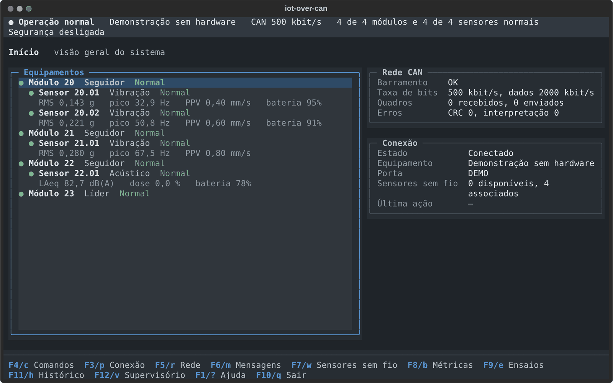
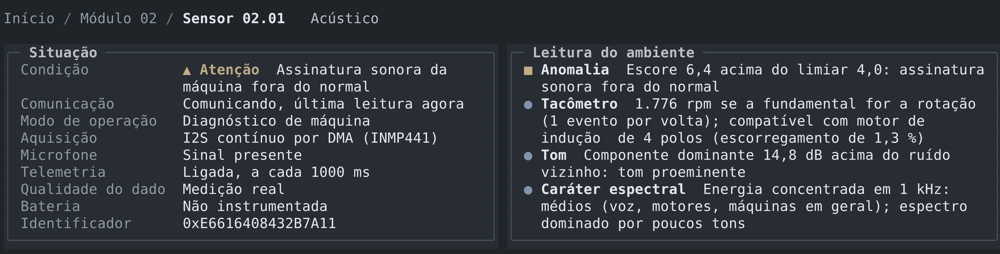
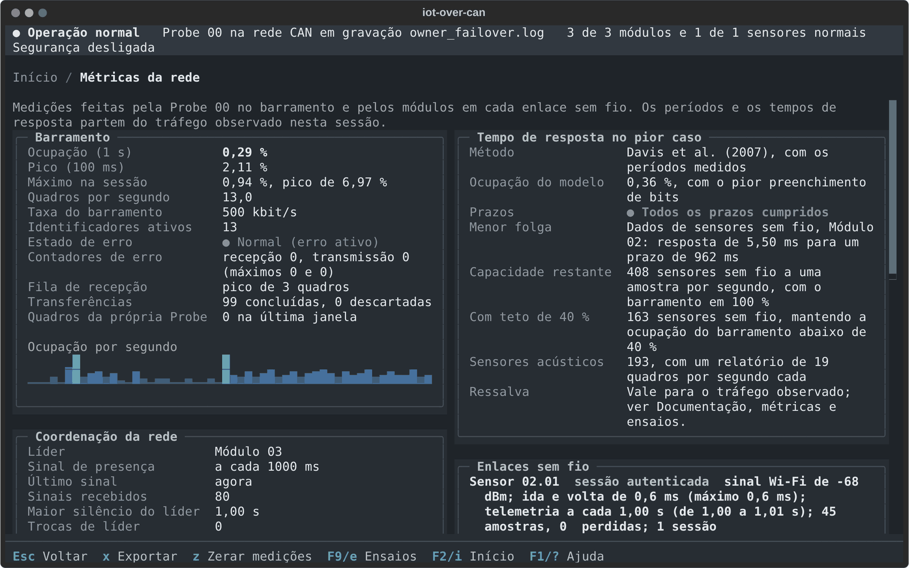

# TUI: estação de operação

A estação de operação é um programa em tela de terminal (TUI, *text user interface*) que mostra a rede, envia comandos e mede o que acontece. Ela se liga à Probe 00 pela USB, ou diretamente ao console USB de um sensor, e funciona também sem hardware. O código está em `Front/pico_tui/`; a organização interna está em [Integração](integracao.md#estação-de-operação-frontpico_tui).



## 1. Abrir a estação

```bash
./Codigo/scripts/setup_tui.sh                    # uma vez; cria Front/.venv
./Codigo/scripts/run_tui.sh /dev/ttyUSB0         # com a Probe 00
./Codigo/scripts/run_tui.sh                      # sem porta: F3 escolhe depois
```

O programa instalado é `Front/.venv/bin/iot-over-can-tui`. Opções:

| Opção | Efeito |
|---|---|
| `--port <porta>` | porta serial; sem ela, a estação abre o seletor |
| `--mode auto\|probe\|sensor` | tipo de equipamento na porta (padrão: detectar) |
| `--demo` | rede de demonstração, sem hardware |
| `--replay <arquivo> [--replay-speed N]` | reproduz uma sessão gravada |
| `--sim [--sim-binary <arquivo>]` | abre o laboratório virtual e se conecta a ele |
| `--security-mode off\|presence\|otp` | autorização dos comandos (padrão: `presence`) |
| `--operator-mode auto\|required\|off` | identificação de quem opera (padrão: `auto`; ver [Segurança](seguranca.md#5-identificação-do-operador)) |
| `--operators-file <arquivo>` | cadastro de operadores (padrão: `~/.config/iot-over-can/operators.json`) |
| `--operator-idle <minutos>` | inatividade até a sessão do operador expirar (padrão: 15; `0` desliga) |
| `--messages`, `--no-messages` | mostra ou oculta as mensagens recentes no Início |
| `--ascii` | símbolos simples, para terminais sem Unicode |
| `--no-file-log` | não grava a sessão em arquivo |

Python 3.11 ou mais novo; as versões das bibliotecas estão fixadas em `Front/pyproject.toml` (Textual 8.2.8, Rich 15.0.0, pySerial 3.5).

## 2. Princípios

1. **Uma tela por assunto.** Visão geral, módulo, sensor, comandos, rede, mensagens, sensores sem fio, métricas, ensaios e histórico têm telas próprias.
2. **Estado antes de detalhe.** A tela inicial responde primeiro se há algo que exige atenção.
3. **Ações visíveis.** A barra de teclas mostra o que se pode fazer em cada tela; nada essencial depende de atalho escondido.
4. **Nenhuma ação sem caminho.** Telemetria, espectro e configuração de um sensor só são oferecidos enquanto o canal de dados está aberto.
5. **Sem corte de texto.** O conteúdo quebra em linhas e o layout se adapta ao tamanho do terminal.
6. **Cor com significado.** Superfícies neutras em repouso; cor reservada a atenção, crítico e interação, sempre acompanhada de símbolo e palavra.

## 3. Navegação e teclas

```text
Início
├── Módulo NN
│   └── Sensor NN.CC
│       └── Espectro
├── Comandos
├── Rede CAN
├── Mensagens
├── Sensores sem fio
├── Métricas da rede
├── Ensaios
├── Histórico
├── Supervisório
└── Ajuda
```

`Enter` abre o item realçado, `Esc` volta. Teclas globais:

| Tecla | Tela |
|---|---|
| `F1` ou `?` | Ajuda |
| `F2` ou `i` | Início |
| `F3` ou `p` | Conexão (escolher ou trocar a porta) |
| `F4` ou `c` | Comandos |
| `F5` ou `r` | Rede CAN |
| `F6` ou `m` | Mensagens |
| `F7` ou `w` | Sensores sem fio |
| `F8` ou `b` | Métricas da rede |
| `F9` ou `e` | Ensaios |
| `F11` ou `h` | Histórico |
| `F12` ou `v` | Supervisório |
| `F10` ou `q` | Sair |
| `k` | lançador de comandos |
| `o` | operador: entrar, sair da sessão ou ver quem está identificado |
| `/` | medições de pesquisa |

Com um campo de texto em foco, as letras são texto, não atalhos. `k`, `o` e `/` não aparecem na barra de teclas (`o` aparece no Início); estão na Ajuda.

## 4. Telas

### Início

A faixa do topo resume a condição geral, a conexão, o barramento e quantos equipamentos estão normais. Abaixo vêm **Precisa de atenção** (só o que tem problema, do mais grave para o mais leve), **Equipamentos** (módulos e, abaixo de cada um, os seus sensores), **Rede CAN** e **Conexão**. Um sensor associado só aparece depois que o módulo confirma o vínculo; enquanto o canal de dados não abre, a linha dele diz em que etapa a criação está.

### Módulo

Situação (condição, papel, estado no barramento, firmware, tempo ligado), função local, sensores associados, sensores que o módulo ouve por BLE e as ocorrências do módulo. `c` abre os comandos do módulo e `s` pede o estado atualizado.

### Sensor

A tela se adapta ao tipo do sensor e ao canal disponível.

- **Sem canal de dados**, a seção Situação mostra o vínculo, o módulo responsável, o sinal e o estado do canal (sem informação, sem canal, oferta anunciada, autenticação em andamento, sessão ativa ou módulo sem chave). A seção **Criação do canal de dados** lista as etapas do vínculo à primeira leitura, com a hora de cada uma, a etapa em espera e há quanto tempo, o motivo de uma falha e o que verificar. Nesse estado, só desassociar (`d`) e Sensores sem fio (`w`) são oferecidos.
- **Com canal de dados**, a tela mostra situação, modo, aquisição, métricas, tendências, alarmes e configuração, e a seção de comunicação passa a mostrar o canal: sinal Wi-Fi, idade da sessão, leituras e perdas no barramento e no Wi-Fi, mensagens recusadas por autenticação ou repetição.
- **Sensor de vibração:** valor eficaz, pico espectral, velocidade de pico (PPV), curtose, fator de crista, entropia e o detector de eventos, conforme o modo.
- **Sensor acústico:** níveis sonoros (LAeq, LCeq, LZeq, LAF, pico) com bandas de oitava; um painel por modo (exposição ao ruído com as doses NR-15 e NHO-01, diagnóstico de máquina com tacômetro acústico e escore de anomalia, ou eventos sonoros com classe, pico e SEL); a leitura do ambiente em frases curtas; e os eventos da sessão. Detalhes em [Sensor acústico](sensor-acustico.md#10-análises-na-tui).



Teclas: `f` espectro, `c` comandos, `s` estado, `l` limites de alarme, `d` desassociar; no sensor acústico, `z` reinicia a medição e `a` aprende a assinatura normal (modo de máquina). Ações que só existem no console USB do sensor não são oferecidas pelo módulo.

### Sensores sem fio

A tela de descoberta e vínculo.

- **Disponíveis:** cada UUID aparece uma vez, com o perfil, o módulo que o ouve melhor e quantos módulos o ouvem. Só valem observações dos últimos 15 s. **Detalhes** lista todas as observações por sinal; a primeira é a recomendação, não uma decisão.
- **Associar** (`Enter` ou `a`): escolha o módulo entre os que ouviram o sensor e a política (reassociação automática ou só pelo operador).
- **Associados:** `NN.CC`, perfil, UUID, módulo, estado, sinal e política. `f` muda a política; `d` desassocia, com confirmação.

A estação não cria nem remove sensores por conta própria: o sensor aparece quando o módulo confirma o vínculo e some quando o módulo confirma a desassociação. Quando o líder reassocia um sensor, o registro passa para o novo módulo e a troca gera uma ocorrência nos dois.

### Comandos

O lugar dos comandos operacionais. O alvo pode ser a rede, um módulo ou um sensor; `t` troca o alvo. As ações, agrupadas em Consultar, Operar e Manutenção, trazem descrição, parâmetro guiado, a linha CAN quando houver e a exigência de autorização. Depois do envio, a tela volta para onde foi aberta. `a` abre o campo de **comando manual**, para diagnóstico: texto sem `:` vai ao equipamento conectado; com `:`, executa um comando interno, por exemplo `:status`, `:node 04.01`, `:can 22 20 FF 00`, `:bind`, `:unbind`, `:policy`, `:metrics`, `:ensaios`, `:tel`, `:fft`, `:dtc`, `:config`, `:measure`, `:baseline`, `:cal`, `:connect`, `:snapshot`, `:security`, `:lock`, `:login`, `:logout`, `:operador` e `:quit`.

O **lançador de comandos** (`k`) é uma linha de entrada rápida: o operador digita, por exemplo, `22 00 FF 01`, a janela explica o que vai acontecer e `Enter` envia. As setas recuperam os últimos 50 comandos. As regras de autorização são as mesmas.

### Rede CAN

Estado do barramento, taxa de bits, contadores de erro, quadros e bytes, transferências em curso, dados da Probe 00 e os 40 quadros mais recentes.

### Mensagens

O registro da sessão, até 2000 entradas, separado do estado contínuo: leituras periódicas não viram mensagens. `d` mostra ou oculta as de depuração, `h` liga as mensagens recentes no Início e `l` limpa a vista. O registro técnico completo fica no arquivo da sessão.

### Métricas da rede

Ocupação do barramento (com gráfico por segundo), coordenação da rede (líder, sinal de presença, eleições, reassociações), tempos de resposta dos comandos, o pior tempo de resposta estimado de cada mensagem com a capacidade restante, os canais sem fio e as mensagens por identificador. `x` exporta tudo para `exports/` em JSON e CSV; `z` zera os acumulados.



A análise de tempo de resposta é uma estimativa a partir do tráfego observado, e a tela diz isso; o método e as ressalvas estão em [Arquitetura](arquitetura.md#análise-de-tempo-de-resposta).

### Ensaios

À esquerda, os ensaios; à direita, o que o ensaio realçado faz, o que mede e o que fazer depois. Abaixo, o ensaio em curso e os resultados.

| Ensaio | Comando enviado |
|---|---|
| Queda do líder | `FAULT POWER_CYCLE <líder> <s>` |
| Queda de um módulo | `FAULT POWER_CYCLE <módulo> <s>` |
| Módulo congelado | `FAULT SILENCE <módulo> <s>` |
| Queda do ponto de acesso | `FAULT AP_OUTAGE <módulo> <s>` |
| Sessões descartadas | `FAULT DROP_SESSION <módulo>` |
| Carga de alta ou baixa prioridade | `FAULT LOAD <pct> <s> HIGH\|LOW` |
| Ensaio manual | nenhum: marca o início e o fim de uma falha provocada à mão |

`Enter` inicia: a estação pede o módulo, a duração e, na carga, o percentual, mostra o comando e pede confirmação. O resultado é medido pelas mensagens da rede: tempo até a falha ser percebida, até a rede voltar, maior intervalo sem telemetria, eleições, reassociações. Uma medida não obtida aparece como "não observado", nunca como zero. `s` encerra o ensaio antes da hora. Depois de uma queda, o módulo fica marcado em falha até *Limpar falha*.

### Histórico

As sessões anteriores, guardadas em `logs/historico.sqlite3`: eventos da rede, do barramento, dos canais sem fio, dos sensores e do sistema, e agregados do barramento a cada 30 s. Escolha a sessão; a linha do tempo mostra as categorias e, abaixo, os eventos da janela.

| Tecla | Ação |
|---|---|
| `←` `→` | evento anterior e seguinte |
| `PageUp` `PageDown` | desloca a janela |
| `+` `-` | amplia e reduz a escala |
| `m` `M` | próxima e anterior marca do operador (vindas do painel) |
| `,` `.` | arquivos de captura do evento |
| `u` | atualiza a lista de sessões |

Eventos importantes disparam uma **captura**: a telemetria e o estado em torno do evento (60 s antes e 120 s depois), gravados em CSV em `logs/capturas/<data>/<id>/`. Um alarme de um sensor captura o sensor; a perda de um canal captura o módulo; eleições, reassociações e erros no barramento capturam a rede.

### Supervisório

Até cinco painéis na mesma tela: rede e barramento (ocupação, erros, uso do barramento pelos dados de cada módulo), módulos CAN e um painel por sensor. A borda de cada painel toma a cor da condição. `a` acrescenta, `x` remove, `Tab` passa ao próximo, `<` `>` reordenam e `Enter` abre a tela completa. A composição fica nas preferências e volta na próxima sessão.

### Espectro

O espectro do sensor, com picos e parâmetros, ocupando a largura disponível; `n` pede um novo. No sensor acústico, em dB SPL. Pelo módulo, o espectro chega reduzido ao número de faixas pedido.

### Medições de pesquisa

A tela `/` reúne medições da instrumentação usada pela ferramenta de [Pesquisa](../Pesquisa/README.md): ida e volta pelo canal de dados (`ECHO`), variação do sinal de presença, ocupação sob carga, custo da criptografia e parâmetros da compilação. Ela só lê; os comandos são enviados pelo lançador (`k`).

## 5. Alarmes por limite

Na tela de um sensor, `l` abre os limites de alarme do perfil: valor eficaz, PPV, curtose e fator de crista no sensor de vibração; LAeq, pico, doses e escore de anomalia no acústico. Campo vazio é métrica sem alarme. O alarme acende quando a leitura passa do limite e apaga quando volta abaixo do limite menos uma folga (5 % para valor eficaz e PPV, 1 dB para níveis). Aceso, ele vira condição de atenção do sensor, aparece no Início, no supervisório e nas mensagens, e fica registrado. Os limites valem também para sensores que ainda vão aparecer.

## 6. Gravação e reprodução

Cada sessão com hardware é gravada em `logs/gravacao_<data>_<sessão>.log`, com os comandos enviados como comentários. Tokens e chaves são gravados como `***`. A gravação é reproduzida como uma sessão normal:

```bash
cd Front
.venv/bin/python -m pico_tui --replay logs/gravacao_<data>_<sessão>.log --replay-speed 4
```

Na reprodução nenhum comando é enviado, e as durações medidas usam o relógio da gravação. `Front/replays/` traz uma gravação de cada cenário da bancada virtual. Um problema visto na bancada física pode assim ser revisto na estação e virar caso de teste.

## 7. Condição, cores e símbolos

| Nível | Símbolo | Com `--ascii` | Exemplos |
|---|---|---|---|
| Sem dados | `○` | `-` | equipamento ainda não ouvido |
| Normal | `●` | `o` | |
| Atenção | `▲` | `!` | alarme de aviso, vínculo `STALE`, barramento em erro passivo, alarme por limite |
| Crítico | `■` | `X` | alarme crítico, comunicação perdida, barramento desligado |

A condição geral é a pior entre os equipamentos, sem contar várias causas do mesmo equipamento como equipamentos diferentes. Ocorrências repetidas em pouco tempo são agrupadas. A paleta (Aço industrial) usa fundos cinza-azulados, azul para foco, verde para normal, âmbar para atenção e vermelho para crítico.

O layout tem quatro faixas: abaixo de 60 colunas, uma coluna sem bordas laterais; de 60 a 99, uma coluna; a partir de 100, duas colunas; e, com menos de 30 linhas, espaçamentos menores.

## 8. Segurança na estação

Antes de enviar um comando que altera a rede, a estação consulta o `SecurityManager`. São tratados assim os comandos de eleição (`22 00`), administração de módulos (`22 10`), período do sinal de presença (`22 30`), associação (`WIRELESS BIND`, `UNBIND`, `POLICY`), comandos a sensores (`CMD`), ensaios (`FAULT`) e as alterações no console USB de um sensor. Sem autorização, o comando é bloqueado. Consultas (`22 20`), medições (`METRICS`) e o ajuste do relógio (`TIME`) são livres. O modelo completo está em [Segurança](seguranca.md).

### Quem está operando

A estação sabe quem a usa e grava o nome de quem agiu no histórico. Com operadores cadastrados (`./Codigo/scripts/operadores.sh add NOME`), a faixa de status mostra `Operador sem login` até alguém teclar `o`, informar nome e senha e entrar; dali em diante mostra o nome. Sem login, a pessoa vê tudo e não altera nada: o comando é recusado e a tentativa fica registrada. A sessão expira depois de 15 minutos sem teclado, mouse ou comando; `o` de novo mostra a sessão e permite sair. Sem nenhum cadastro, o responsável é o usuário do sistema operacional, marcado como `(sistema)`.

No histórico (`h`), as ações aparecem na faixa `AUDIT`, com o autor na lista e em **Responsável** nos detalhes. A resposta do firmware a uma associação aparece em **Autorizado por**, com o nome de quem pediu. Como cadastrar operadores, consultar e conferir a auditoria: [Segurança](seguranca.md#5-identificação-do-operador).

## 9. Arquivos da estação

| Arquivo | Conteúdo |
|---|---|
| `~/.config/iot-over-can/tui.json` | preferências: mensagens no Início, depuração, símbolos ASCII, painéis do supervisório, limites de alarme |
| `~/.config/iot-over-can/security.json` | token de manutenção (segredo; permissão só do dono) |
| `~/.config/iot-over-can/operators.json` | operadores cadastrados, com a senha em hash (permissão só do dono) |
| `logs/` | registro da sessão, gravações, histórico (`historico.sqlite3`) e capturas |
| `exports/` | métricas e ensaios exportados |

`logs/` e `exports/` ficam na pasta em que a estação é aberta (`Front/`, pelos scripts). Uma falha ao ler as preferências não impede a abertura: a estação usa os padrões e avisa.

## 10. Limitações

- A demonstração não reage aos ensaios de falha; para vê-los sem hardware, use uma gravação ou o laboratório virtual.
- A variação de período medida pela Probe inclui a latência dela, da ordem de 1 ms.
- Depois de reiniciar, um módulo leva 12 s para retomar os vínculos gravados; nesse intervalo o sensor aparece sem sessão.
- Só os perfis de vibração e acústico têm tela especializada; outros perfis mostram os campos recebidos.
- As leituras acústicas são indicativas: o INMP441 não é um medidor de nível sonoro normatizado.
