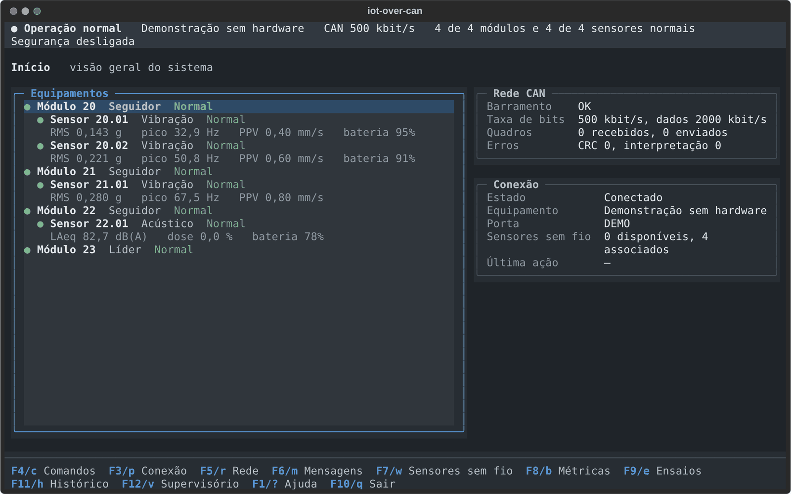

# iot-over-can

O **iot-over-can** liga sensores sem fio a uma rede **CAN**, o barramento de fios usado em carros, máquinas e equipamentos industriais. A rede CAN existente continua do mesmo jeito; os sensores se integram a ela.

Os sensores medem vibração e som e se comunicam por rádio com pequenos módulos ligados ao barramento. Cada módulo confere a identidade do sensor antes de aceitar qualquer dado e leva as medições pelo CAN até a estação de operação, no computador. Se um módulo sai do ar, a rede se reorganiza sozinha e, quando o operador autoriza, outro módulo assume os sensores dele.



## Como as peças se ligam

```text
 Sensor de vibração ┐                    ┌─ Módulo CAN 1 ─┐
 Sensor acústico    ├── rádio ─────────► ├─ Módulo CAN 2 ─┼══ barramento CAN ══ Probe 00 ── USB ── computador (TUI)
 Painel de operação ┘  (BLE + Wi-Fi)     └─ Módulo CAN 3 ─┘
```

| Peça | Função | Hardware |
|---|---|---|
| **Módulo CAN** (Node) | forma a rede: elege um líder, vigia os demais e atende os sensores sem fio | ESP32 + controlador CAN MCP2515 |
| **Probe 00** | instrumento de bancada: observa o barramento e leva comandos do computador; a rede funciona sem ela | ESP32 + MCP2515, ligado ao computador por USB |
| **Sensor de vibração** | mede vibração de máquinas e estruturas | Raspberry Pi Pico W + acelerômetro MPU6050 |
| **Sensor acústico** | mede nível sonoro, exposição ao ruído, o som de máquinas e eventos sonoros | Pico W ou Pico 2 W + microfone INMP441 |
| **Painel de operação** | mostra a situação da rede no local, sem computador | ESP32-2432S028, tela de 2,8" com toque |
| **TUI** | estação de operação: telas de supervisão, comandos, medições e ensaios | computador com Python, no terminal |

## O que o sistema faz

- **Rede que se organiza sozinha.** Os módulos elegem um líder, percebem quando um deles some e escolhem outro líder se o atual falhar.
- **Sensores escolhidos pelo operador.** Vários módulos podem ouvir o mesmo sensor; a estação mostra qual o ouve melhor, mas quem decide o responsável é o operador.
- **Canal de dados autenticado.** Sensor e módulo provam um ao outro que conhecem a mesma chave antes de trocar qualquer dado. Dados adulterados ou repetidos são descartados.
- **Reassociação automática.** Com a autorização do operador, o líder passa um sensor a outro módulo quando o responsável sai do ar ou deixa de alcançá-lo.
- **Dados de sensores sem atrapalhar a rede.** No CAN, as mensagens dos sensores têm a menor prioridade: nunca atrasam a coordenação entre os módulos.
- **Relógio comum.** A estação ajusta a hora de toda a rede pela Probe 00.
- **Medição e ensaios.** A estação mede a ocupação do barramento e os tempos de resposta, e provoca falhas controladas (queda de módulo, carga no barramento) para ver como a rede reage.
- **Laboratório virtual.** O firmware real dos módulos roda no computador, em vários módulos simulados ao mesmo tempo, para testar tudo sem hardware.

## Estado atual

Todo o código é verificado automaticamente no computador a cada mudança: testes das bibliotecas, simulação do canal de dados, a bancada virtual com o firmware real dos módulos e os testes da estação. A compilação de todos os firmwares é conferida na integração contínua.

Na bancada física, a rede CAN, a descoberta e a associação de sensores, o canal de dados com um sensor de vibração e uma reassociação automática já funcionaram. As correções posteriores na abertura do canal de dados, o sensor acústico, o painel na ESP32-2432S028 e o relógio da rede foram verificados só na bancada virtual e ainda precisam ser conferidos com o hardware. O detalhe está em [Validação](Documentacao/validacao.md).

## Primeiros passos

Para conhecer a estação sem nenhum hardware (Linux ou macOS, com Python 3.11 ou mais novo):

```bash
git clone https://github.com/marcelo-carvalhop/iot-over-can.git
cd iot-over-can
./Codigo/scripts/setup_tui.sh                  # cria o ambiente Python e instala a estação
Front/.venv/bin/iot-over-can-tui --demo        # abre com uma rede de demonstração
```

O [Guia de uso](Documentacao/guia-de-uso.md) mostra também como reproduzir uma sessão gravada, rodar o laboratório virtual e montar a bancada com o hardware.

## Documentação

| Documento | Para quem | Conteúdo |
|---|---|---|
| [Guia de uso](Documentacao/guia-de-uso.md) | quem vai montar e operar | hardware, instalação, gravação, colocar a rede no ar, operação, solução de problemas |
| [Arquitetura](Documentacao/arquitetura.md) | quem quer entender como funciona | papéis, rede CAN, sensores sem fio, canal de dados, reassociação, painel, relógio, medição, CAN FD |
| [Protocolo](Documentacao/protocolo.md) | quem desenvolve | mapa de identificadores CAN, formatos das mensagens, comandos e linhas da Probe 00 |
| [Integração](Documentacao/integracao.md) | quem vai fazer um fork ou estender | mapa do código, como acrescentar sensores, mensagens e telas, convenções |
| [TUI](Documentacao/tui.md) | operadores e desenvolvedores | todas as telas, teclas e arquivos da estação de operação |
| [Sensor acústico](Documentacao/sensor-acustico.md) | quem usa ou estende o sensor de som | hardware, aquisição, medição, modos e análises |
| [Segurança](Documentacao/seguranca.md) | todos | chaves, autorização de comandos, ameaças consideradas e limites |
| [Validação](Documentacao/validacao.md) | quem testa | testes automáticos, bancada virtual, laboratório virtual e bancada física |
| [Desafios](Documentacao/desafios.md) | quem desenvolve | problemas encontrados e como foram resolvidos |

Documentos de etapas anteriores ficam, sem revisão, em [`Documentacao/historico/`](Documentacao/historico/). A ferramenta de pesquisa tem a própria documentação em [`Pesquisa/`](Pesquisa/README.md).

## Licença

Copyright (C) 2026 Marcelo de Carvalho Pereira.

Este projeto é software livre, distribuído sob a **GNU General Public License, versão 3** ([`LICENSE`](LICENSE)). Você pode usar, estudar, modificar e redistribuir o código. Quem distribuir uma versão modificada precisa mantê-la sob a mesma licença e oferecer o código-fonte dela. O projeto é oferecido sem garantia; os termos exatos estão na licença.
